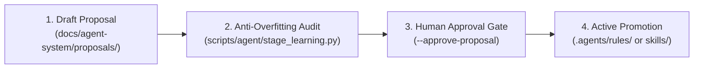

# Controlled Learning & Rule Authoring Skill

> **Governance Authority**: `rule_learning_and_skill_authoring.md` (`RULE-CORE-004`)  
> **Deterministic Engine**: `scripts/agent/stage_learning.py` (`MOD-LEARN-001`)  
> **Status**: Non-Negotiable Hard Constraint.

---

## 1. Intent & Purpose

This skill prevents autonomous prompt pollution, rote memorization, and context bloat during `/learn` sessions. It enforces the **3-Step Controlled Learning Gate**:



---

## 2. Step-by-Step Execution Protocol

### Step 1: Extract Mistake Class & Draft Proposal
1. Identify the underlying failure class rather than the one-time error symptom.
2. Confirm the learning satisfies either:
   - **Generality $\ge 3$**: Applicable across $\ge 3$ distinct projects, tools, or files.
   - **Critical Prevention Exception**: Structured as explicit `[SPECIFIC CASE]` + `[GENERAL PRINCIPLE]`.
3. Draft proposal in `docs/agent-system/proposals/LEARN-XXXX-<topic>.md` with frontmatter:

```yaml
---
id: LEARN-0001
title: Dynamic Dimension Extraction Over Hardcoded Layout
target_type: rule
trigger: model_decision
description: Invariant requiring layout dimensions to be dynamically measured from template XML rather than hardcoded.
status: proposal
generality_score: 4
created_at: 2026-10-19T10:00:00Z
---
```

### Step 2: Deterministic Anti-Overfitting & Budget Audit
Run deterministic verification against the proposal:

```bash
python scripts/agent/stage_learning.py --audit docs/agent-system/proposals/LEARN-XXXX-<topic>.md
```

**Mechanical Gates Checked**:
- Zero hardcoded foreign or absolute paths (`ERR_LEARN_OVERFIT`).
- Zero hardcoded single-dataset coordinates (`ERR_LEARN_OVERFIT`).
- Character budget $\le 12,000$ characters (`ERR_LEARN_BUDGET`).
- Valid frontmatter schema (`ERR_LEARN_SCHEMA`).

### Step 3: Human Authorization & Promotion Gate
Rules and skills **cannot be promoted autonomously**. Promotion requires explicit user approval:

```bash
python scripts/agent/stage_learning.py --promote docs/agent-system/proposals/LEARN-XXXX-<topic>.md --approve-proposal
```

### Step 4: Registry & Integrity Sync
After promotion, synchronize reference hashes and verify documentation integrity:

```bash
python scripts/agent/validate_registry.py --update-hashes
python scripts/agent/check_docs.py
```
