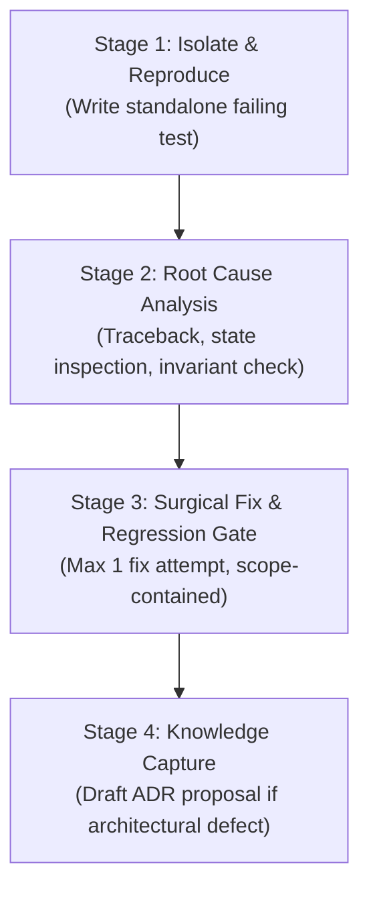

# Skill: Systematic Bug Investigation & Root Cause Isolation

> **Purpose**: Establish an evidence-based, reproducible debugging workflow that eliminates trial-and-error code thrashing and captures defect lessons into durable ADRs.  
> **Companion Rules**: See [rule_anti_evasion.md](../../rules/rule_anti_evasion.md), [rule_critical_engagement.md](../../rules/rule_critical_engagement.md), and [AGENTS.md](../../../AGENTS.md).

---

## 1. When to Use
- Investigating any defect, regression, unexpected exception, or failing test in software or hardware simulation.
- Formulating a minimal reproduction case before proposing code changes.
- Root cause diagnosis that may require an Architectural Decision Record (ADR).

---

## 2. The 4-Stage Investigation Protocol



### Stage 1: Isolate & Reproduce
1. Never edit production code until the bug is deterministically reproduced.
2. Create a minimal reproduction test under `tests/` (e.g. `tests/repro_issue_XXX.py`):
   - Strip all unrelated dependencies.
   - Assert the exact expected behavior vs the observed faulty behavior.
3. Run the reproduction test and confirm it fails with the exact reported error:
   ```powershell
   python -m unittest tests/repro_issue_XXX.py
   ```

### Stage 2: Root Cause Analysis
1. Extract the verbatim traceback and inspect the exact `file:line` where the invariant broke.
2. Determine the defect classification:
   - **Data Contract Mismatch**: Schema field missing or type violated.
   - **State Desynchronization**: Cache or derived pointer drifted from SSOT.
   - **Boundary / Geometry Edge Case**: Off-by-one, empty list, or overflow.
   - **Concurrency / Timing Race**: Clock domain crossing or async ordering.
3. Check against project invariants: Does this bug reveal an unwritten assumption or a violation of [ARCHITECTURE.md](../../../ARCHITECTURE.md)?

### Stage 3: Surgical Fix & Regression Gate
1. Under the **Fail-Closed Discipline** ([AGENTS.md](../../../AGENTS.md)):
   - Apply at most **1 targeted fix** within the declared `in_scope`.
   - Run the reproduction test: it must now pass with exit code `0`.
   - Run the entire regression suite:
     ```powershell
     python -m unittest discover -s tests -p "test_*.py"
     ```
2. If the fix fails or breaks other tests: **STOP immediately**. Do not rewrite code blindly. Report the raw traceback and await guidance.

### Stage 4: Knowledge Capture & ADR Proposal
1. If the bug was caused by an ambiguous architecture decision, draft an ADR in `docs/agent-system/decisions/` with `authority: "proposal"`.
2. Move the reproduction test into the permanent regression test suite.
