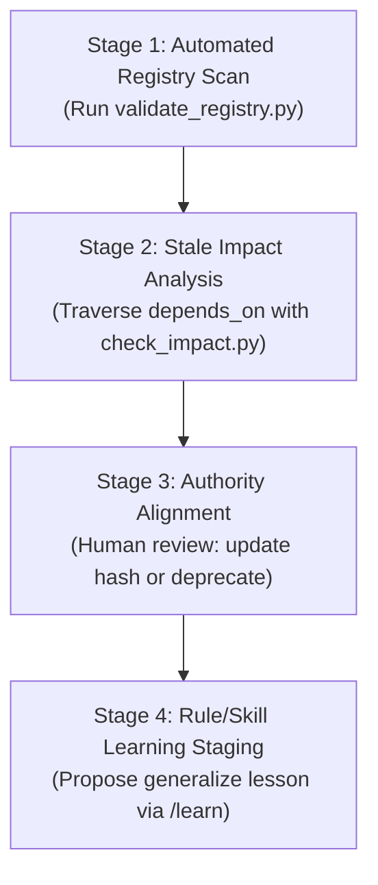

# Skill: Knowledge Review & Reference Registry Audit

> **Purpose**: Maintain the integrity, freshness, and authority of the project's knowledge base, preventing stale documentation and unverified assumptions from contaminating task contracts.  
> **Companion Rules**: See [rule_task_contract_and_scope.md](../../rules/rule_task_contract_and_scope.md), [rule_learning_and_skill_authoring.md](../../rules/rule_learning_and_skill_authoring.md), and [AGENTS.md](../../../AGENTS.md).

---

## 1. When to Use
- Sprint or milestone retrospectives to audit documentation freshness.
- When `validate_registry.py` detects a `ERR_REG_STALE_HASH` warning/error.
- Prior to proposing architectural updates or deprecating obsolete specifications.
- Staging lessons learned into `/learn` proposals.

---

## 2. The 4-Stage Knowledge Review Protocol



### Stage 1: Automated Registry Scan
1. Execute the deterministic registry and context budget audit:
   ```powershell
   python scripts/agent/validate_registry.py
   ```
2. Inspect the output issues:
   - `ERR_REG_MISSING_PATH`: File deleted or moved without updating registry.
   - `ERR_REG_STALE_HASH`: File modified on disk; recorded hash is out of date.
   - `ERR_REG_CYCLE`: Circular dependency in `depends_on`.
   - `WARN_CTX_BUDGET_HIGH`: Always-on rules approaching the $15\%$ budget limit ($3,000$ tokens).

### Stage 2: Stale Impact Analysis
1. For every stale or modified reference, identify all downstream dependents before accepting changes:
   ```powershell
   python scripts/agent/check_impact.py --target <STALE_REF_ID>
   ```
2. Review the `transitive_dependents` list:
   - Identify dependent code modules, task contracts, and tests that require re-verification.

### Stage 3: Authority Alignment & Hash Refresh
1. If the changes in the reference represent valid approved evolutions:
   - Obtain human confirmation.
   - Refresh recorded hashes:
     ```powershell
     python scripts/agent/validate_registry.py --update-hashes
     ```
2. If the document is obsolete:
   - Transition `authority: "deprecated"` and `status: "superseded"`.
   - Re-route any active tasks dependent on it.

### Stage 4: Rule/Skill Learning Staging (`/learn`)
1. In accordance with [rule_learning_and_skill_authoring.md](../../rules/rule_learning_and_skill_authoring.md):
   - Never turn a single-file bug into a global rule (avoid rote memorization).
   - Only propose a new rule if the principle applies across $\ge 3$ distinct scenarios.
   - Draft the rule in an artifact with `RequestFeedback: true` and await explicit user approval.
