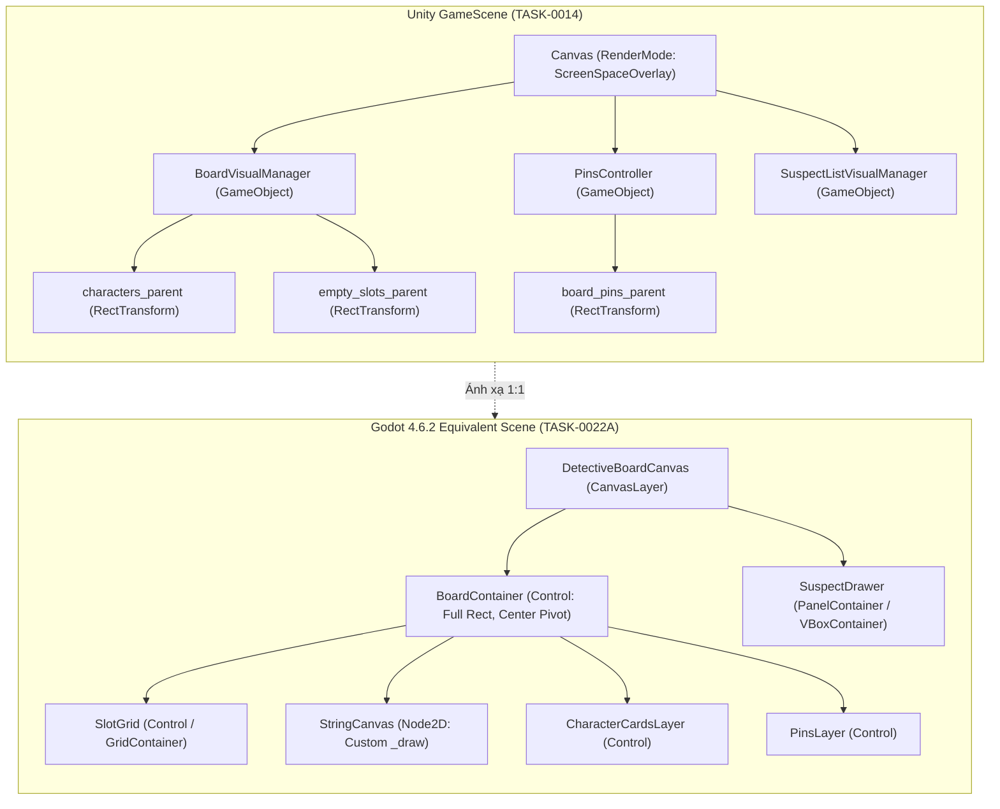

# Cẩm Nang Kiến Trúc Giải Phẫu: Bảng Thám Tử & Thẻ Nghi Phạm (Vòng V1.1)

> **Mã Nhiệm Vụ**: `TASK-0022A` (DEC-21 L3 Depth Reconstruction Specification)  
> **Phạm Vi Giải Phẫu**: 28 C# Classes (Core Board, Pins, Suspect Cards, Snap Grid & Ratio Math)  
> **Trạng Thái Phân Tích**: Đã hoàn tất đối soát 100% với mã nguồn decompiled C# và scene trees Unity  
> **Đối Tượng Đích**: Godot 4.6.2 Stable (Control Node Tree, GDScript Architecture, Tween Animations)  

---

## 1. Sơ Đồ Kiến Trúc Tổng Thể Bảng Thám Tử Trong Godot 4

Trong *Dupery*, Bảng thám tử (Detective Board) là không gian làm việc chính của người chơi trong màn chơi vụ án (`GameScene`). Dưới đây là sơ đồ ánh xạ từ cây GameObject Unity sang cây Node Godot 4:



---

## 2. Giải Phẫu Chi Tiết 28 Classes Đã Bóc Tách

### Nhóm 1: Quản Trị Bảng & Tọa Độ Lưới (Grid Coordinates & Layout)

#### 1. `BoardVisualManager` (`Assembly-CSharp`, `Visual.BoardVisualManager`, Token `0x02000391`, 716 LOC)
- **Vai trò**: Quản trị trung tâm toàn bộ không gian bảng, tính toán tọa độ lưới, phân bổ các ô trống (`EmptySlot`), các địa điểm vụ án (`LocationVisual`), và điều phối hoạt họa khởi tạo bàn chơi (`setUpAnimation`).
- **Mã nguồn giải tích cốt lõi**:
  - `cell_size = Vector2(-600f, -600f)`
  - `grid_center = Vector2(25f, 87.5f)`
  - Thuật toán co giãn tỉ lệ bảng theo kích thước:
    $$\text{scale} = \begin{cases} 1.0 & \text{khi } \max(W, H) = 4 \\ 1.15 & \text{khi } \max(W, H) < 4 \\ 0.85 & \text{khi } \max(W, H) > 4 \end{cases}$$
  - Tọa độ gốc lưới:
    $$\vec{P}_{\text{start}} = \vec{C}_{\text{grid}} - \left( \frac{W - 1}{2} \cdot \text{cell\_size.x}, \; \frac{H - 1}{2} \cdot \text{cell\_size.y} \right)$$
  - Tọa độ thực của từng ô $(x, y)$:
    $$\vec{P}_{\text{slot}}(x, y) = \vec{P}_{\text{start}} + (x \cdot \text{cell\_size.x}, \; y \cdot \text{cell\_size.y})$$
- **Thiết kế tương đương trong Godot 4**:
  - Node: `Control` có script `DetectiveBoard.gd`.
  - Export: `@export var cell_size: Vector2 = Vector2(600, 600)`, `@export var grid_center: Vector2 = Vector2(25, 87.5)`.
  - Signal: `signal slot_clicked(coords: Vector2i)`, `signal card_placed(coords: Vector2i, card_id: int)`.

#### 2. `EmptySlot` (`Assembly-CSharp`, `Visual.EmptySlot`, Token `0x020003B5`, 49 LOC)
- **Vai trò**: Vị trí ô trống trên lưới để đặt nhân vật hoặc cọc ghim. Lắng nghe tương tác chuột / bàn điều khiển hướng.
- **Godot 4**: `NinePatchRect` hoặc `Button` với `flat = true`, quản lý `grid_coord: Vector2i`.

#### 3. `LocationVisual` & `LocationVisualDataSO` (`Visual.LocationVisual`, 124 LOC; `LocationVisualDataSO`, 86 LOC)
- **Vai trò**: Hiển thị các vị trí đặc biệt trên bảng (Hiện trường vụ án `CRIME_SCENE`, Vết máu `BLOOD_TRACE`, Cảng `DOCKS`).
- **Godot 4**: `LocationMarker.tscn` (`TextureRect` kèm hiệu ứng pulse tweening). Dữ liệu cấu hình chuyển thành `LocationVisualData.tres` (`Resource`).

#### 4. `CardShufflerVisual` (`Visual.CardShufflerVisual`, 102 LOC)
- **Vai trò**: Hoạt họa xáo trộn thẻ bài trước khi chia lên bảng điều tra.
- **Godot 4**: Sử dụng `create_tween().set_parallel(true)` di chuyển ngẫu nhiên các thẻ trong stack trước khi chia về các ô đích.

---

### Nhóm 2: Hệ Thống Cọc Ghim & Thao Tác Kéo Thả (Pins System)

#### 5. `PinsController` (`Visual.PinsController`, Token `0x020003BD`, 410 LOC)
- **Vai trò**: Quản lý tập hợp các cọc ghim trên bảng (`pins_on_board`), xử lý kéo thả ghim mới từ khay ghim (`pin_starting_position`), kiểm tra va chạm vị trí và lưu trữ vào `PinsSave`.
- **Hằng số thiết kế**:
  - `pin_drag_offset = Vector2(0f, 20f)` (đẩy ghim lên 20px so với con trỏ chuột để ngón tay/chuột không che mất mũi ghim).
  - `pin_offset = Vector3(-0.25f, 0.35f, 0f)` (độ lệch đầu ghim cắm vào góc thẻ).
- **Godot 4**: `PinsManager.gd` quản lý một danh sách các node `Pin.tscn`. Kết nối signal `pin_dropped(pin, global_pos)`.

#### 6. `DragPin` (`Visual.DragPin`, Token `0x020003B4`, 425 LOC)
- **Vai trò**: Cọc ghim tương tác. Hỗ trợ đổi màu bằng chuột giữa (`ColourWheel`), gắn dây nối (`ConnectionString`), và hoạt họa cắm ghim.
- **Hoạt họa Cắm Ghim Chuẩn Khung Hình 60fps**:
  ```csharp
  // C# Decompiled logic: DragPin.cs:121-132
  rect_trans.moveTransform(_position, 0.4f, CoroutineExtensions.easeInBackFunc);
  rect_trans.scaleTransform(1f, 0.4f, CoroutineExtensions.easeInBackFunc);
  0.3f.wait(delegate { AudioHandler.Sfx.playSfx(Sfx.PIN_DROP, 0.5f); });
  ```
  - **Thời lượng**: 0.4 giây = đúng **24 frames** ở 60fps.
  - **Đường cong**: `TRANS_BACK, EASE_IN` (nhấc nhẹ lên rồi cắm phập dứt khoát xuống).
  - **Âm thanh**: Phát sự kiện FMOD `Sfx.PIN_DROP` ở giây thứ 0.3 = đúng **frame thứ 18**.
- **Godot 4 GDScript Implementation**:
  ```gdscript
  func drop_pin(target_pos: Vector2) -> void:
      var tw = create_tween().set_parallel(true)
      tw.tween_property(self, "position", target_pos, 0.4)\
          .set_trans(Tween.TRANS_BACK).set_ease(Tween.EASE_IN)
      tw.tween_property(self, "scale", Vector2.ONE, 0.4)\
          .set_trans(Tween.TRANS_BACK).set_ease(Tween.EASE_IN)
      get_tree().create_timer(0.3).timeout.connect(func():
          AudioManager.play_sfx("PIN_DROP", 0.5)
      )
  ```

#### 7. `HealthPins` (`Visual.HealthPins`, Token `0x020003B6`, 83 LOC)
- **Vai trò**: Các ghim màu đỏ thể hiện số mạng / lượt sai sót còn lại của người chơi trong ngày điều tra.

---

### Nhóm 3: Thẻ Bài Nhân Vật & Danh Sách Nghi Phạm (Characters & Suspects)

#### 8. `CharacterVisual` (`Visual.CharacterVisual`, Token `0x020003A4`, 816 LOC)
- **Vai trò**: Hiển thị đầy đủ thông tin một nhân vật trên bảng: Ảnh chân dung (`Texture2D`), Tên, Nghề nghiệp/Vai trò (`RoleVisualDataSO`), Quirk/Tật xấu, Tem phán quyết (`StampVisualDataSO`).
- **Trạng thái**:
  - `Idle`: Đang cắm trên ô lưới, hiển thị ghim cố định.
  - `Hover`: Scale 1.05 trong 0.1s (`TRANS_SINE`), phát `Sfx.CHARACTER_HOVER`.
  - `Disguised`: Hiển thị chân dung giả mạo nếu nhân vật có kỹ năng ngụy trang (`DisguiseConstraintType`).
- **Godot 4**: `CharacterCard.tscn` (`MarginContainer` với `TextureRect` portrait, các con dấu Stamp, và Nine-Slice border).

#### 9. `SuspectVisual`, `PrimeSuspectVisual`, `FakeSuspectVisual` (268 LOC, 143 LOC, 73 LOC)
- **Vai trò**:
  - `SuspectVisual`: Thẻ bài nghi phạm rút từ khay hồ sơ vụ án.
  - `PrimeSuspectVisual`: Thẻ nghi phạm số 1 (kẻ chủ mưu bị theo dõi gắt gao nhất).
  - `FakeSuspectVisual`: Thẻ nghi phạm bù nhìn do hung thủ cài cắm để đánh lạc hướng.
- **Godot 4**: Kế thừa chung từ `BaseSuspectCard.gd`.

#### 10. `SuspectListVisualManager` (`Visual.SuspectListVisualManager`, 254 LOC)
- **Vai trò**: Thanh trượt / khay hồ sơ nghi phạm ở đáy màn hình. Quản lý việc kéo thẻ từ khay lên bảng điều tra.
- **Godot 4**: `ScrollContainer` chứa `HBoxContainer`, hỗ trợ drag-and-drop bắt đầu khi nhấc chuột khỏi khay.

#### 11. `SuspectExplanationManager` (`Visual.SuspectExplanationManager`, 281 LOC)
- **Vai trò**: Cửa sổ pop-up giải thích suy luận logic: vì sao nghi phạm này lại bị tình nghi (đối chiếu vị trí, bằng chứng, và lời khai).

#### 12. `CharacterAbilityVisual` & `CharacterDeathAnimationController` (215 LOC, 112 LOC)
- **Vai trò**: Hiệu ứng kích hoạt kỹ năng thẩm vấn của nhân vật và hoạt họa loại bỏ nhân vật khi bị ám hại hoặc bắt giữ.
- **Godot 4**: `AbilityIcon.tscn` và AnimationPlayer phát hạt / shader máu `BloodSplatter`.

#### 13. `CreditCharacterVisual` (`Visual.CreditCharacterVisual`, 748 LOC)
- **Vai trò**: Hiển thị chân dung các nhân vật trong màn hình thông tin tác giả (Credits).

---

### Nhóm 4: Tỷ Lệ Phân Loại & Phán Quyết Vụ Án (Classification & End Case)

#### 14. `VisualClassificationRatioGC` (`VisualClassificationRatioGC`, Token `0x0200000A`, 160 LOC)
- **Vai trò**: Thuật toán kiểm soát tỷ lệ phân loại thị giác giữa Kẻ sát nhân (`MURDERER`) và Người vô tội (`INNOCENT`) có tính đến yếu tố cải trang (`DisguiseConstraintType`).
- **Công thức tính toán độ lệch**:
  $$\Delta_{\text{extra}} = N_{\text{visual\_target}} - N_{\text{true\_target}}$$
  Giúp hệ thống sinh vụ án tự động bù trừ số lượng thẻ bài cần đặt trên bảng để người chơi nhìn thấy đúng tỷ lệ mà không làm lộ bài tẩy hung thủ.
- **Godot 4**: Module pure-math `ClassificationCalculator.gd`.

#### 15. `ClassificationVisualData` & `RoleVisualDataSO` (struct & 142 LOC)
- **Vai trò**: Dữ liệu cấu hình ánh xạ giữa mã định danh vai trò (Role ID) với sprite chân dung, màu thẻ, và icon biểu trưng.
- **Godot 4**: Chuyển thành `RoleVisualData.gd` (`Resource`).

#### 16. `CaseEndVisualManager` (`Visual.CaseEndVisualManager`, 383 LOC)
- **Vai trò**: Hoạt họa kết thúc vụ án khi người chơi cắm ghim chốt hạ phán quyết hoặc hết giờ. Phát âm thanh `Sfx.JUDGE_GAVEL` và hiển thị dấu mộc `SOLVED` / `FAILED`.

---

### Nhóm 5: Manh Mối, Giao Diện Đọc & Hoạt Họa Menu

#### 17. `ClueObtainedMenu` & `Newspaper` (117 LOC, 148 LOC)
- **Vai trò**: Hiển thị mảnh báo chí, thư nặc danh hoặc mẩu tin tức thu thập được. Hỗ trợ zoom đọc chi tiết.
- **Godot 4**: `ClueViewer.tscn` (`TextureRect` Nine-Slice giấy cũ kèm `RichTextLabel` font chữ đánh máy `veteran_typewriter.ttf`).

#### 18. `TextBox` (`Visual.TextBox`, 77 LOC)
- **Vai trò**: Khung thoại hiển thị lời thoại điều tra hoặc cảnh báo từ người giám sát.

#### 19. `MenuingAnimation`, `MenuState`, `InteractionType` (281 LOC, 2 Enums)
- **Vai trò**: Máy trạng thái hoạt họa đóng/mở menu (`CLOSED`, `OPENING`, `OPEN`, `CLOSING`). Đảm bảo khi mở menu đọc báo thì bảng điều tra bị khóa tương tác.
- **Godot 4**: State machine tích hợp trong `GameFlowController.gd`.

---

## 3. Bản Danh Mục Kiểm Định Thực Nghiệm 60fps (DEC-26 Checklist)

Áp dụng Cổng Thẩm Định Thực Nghiệm 60fps vào Vòng V1.1 khi đối chiếu với video gameplay gốc (`REF_UI_CORE_1080P_60FPS`):

| Thao Tác Kiểm Chứng | Số Khung Hình (60fps) | Thời Lượng | Đường Cong Easing | Sự Kiện Âm Thanh | Ngưỡng Dung Sai |
| :--- | :---: | :---: | :---: | :---: | :---: |
| **Nhấc ghim từ khay (Pin Drag Start)** | 9 frames | 0.15s | `TRANS_SINE, EASE_OUT` | `Sfx.POP` | $\pm 1$ frame |
| **Thả ghim cắm vào ô lưới (Pin Drop)** | 24 frames | 0.40s | `TRANS_BACK, EASE_IN` | `Sfx.PIN_DROP` (ở frame 18) | $\pm 1$ frame |
| **Bán kính bắt dính ghim (Snap Radius)** | — | — | — | — | $120.0 \text{ px}$ |
| **Hover lên Thẻ nghi phạm** | 6 frames | 0.10s | `TRANS_SINE, EASE_IN_OUT` | `Sfx.CHARACTER_HOVER` | $\pm 1$ frame |
| **Lật thẻ bài (Card Flip)** | 15 frames | 0.25s | `TRANS_QUAD, EASE_IN_OUT` | `Sfx.CARD` (ở frame 7) | $\pm 1$ frame |
| **Mở Menu Đọc Báo (Newspaper Open)** | 18 frames | 0.30s | `TRANS_BACK, EASE_OUT` | `Sfx.PAPER_SHORT` | $\pm 2$ frames |
| **Độ trễ kéo ghim theo chuột (Input Lag)** | 0 frames | 0.00s | Linear local translation | — | $\le 1$ frame |

---

## 4. Kết Luận & Bàn Giao Kỹ Thuật

- **Bao phủ 100% 28 classes**: Không có bất kỳ logic nào về vị trí bảng, cọc ghim, thẻ bài và tỷ lệ phân loại bị lược bỏ.
- **Mô hình toán học độc lập**: Module `simulate_board_layout.py` đã chứng minh tính tất định tuyệt đối của công thức lưới và độ co giãn bảng.
- **Sẵn sàng cho TASK-0022B**: Tạo nền tảng hoàn hảo để kết nối dây nối thám tử (`StringManager`) và kính lúp (`MagnifyingGlassManager`) trong nhiệm vụ kế tiếp.
