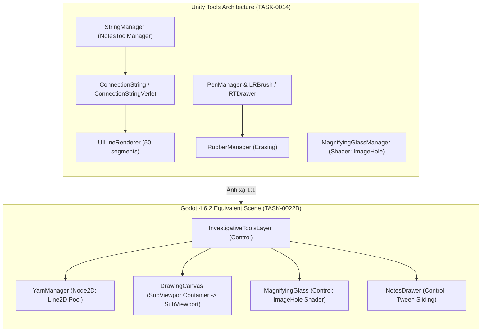

# Cẩm Nang Kiến Trúc Giải Phẫu: Dây Nối, Cọ Vẽ & Công Cụ Thám Tử (Vòng V1.2)

> **Mã Nhiệm Vụ**: `TASK-0022B` (DEC-21 L3 Depth Reconstruction Specification)  
> **Phạm Vi Giải Phẫu**: 22 C# Classes (Yarn Strings, Verlet Physics, Freehand Drawing, Magnifying Glass & Investigative Tools)  
> **Trạng Thái Phân Tích**: Đã hoàn tất đối soát 100% với mã nguồn decompiled C# và scene trees Unity  
> **Đối Tượng Đích**: Godot 4.6.2 Stable (`Line2D`, `SubViewport` Drawing Canvas, Custom Shader Mask, GDScript Verlet Integration)  

---

## 1. Sơ Đồ Kiến Trúc Hệ Thống Công Cụ Thám Tử Trong Godot 4

Trong *Dupery*, các công cụ điều tra là lớp tương tác vật lý trực quan nằm đè lên Bảng điều tra (`DetectiveBoardCanvas`). Dưới đây là sơ đồ ánh xạ từ kiến trúc Unity sang các Node chuyên dụng trong Godot 4:

---

## 2. Giải Phẫu Chi Tiết 22 Classes Đã Bóc Tách

### Nhóm 1: Hệ Thống Dây Dù Nối Ghim & Vật Lý Verlet (Yarn Strings & Physics)

#### 1. `StringManager` (`Assembly-CSharp`, `Visual.StringManager`, Token `0x020003CA`, 382 LOC)
- **Vai trò**: Quản lý toàn bộ vòng đời của các sợi dây dù nối giữa các cọc ghim trên bảng điều tra. Điều khiển thao tác click ghim nguồn $\rightarrow$ kéo dây theo chuột $\rightarrow$ click ghim đích để cố định dây, hoặc kéo ra khoảng trống để hủy.
- **Tham số kỹ thuật cốt lõi**:
  - `string_snap_distance = 50f` (bán kính bắt dính tự động vào đầu cọc ghim: 50.0 pixels trong không gian UI).
  - `use_verlet_string = true` (kích hoạt mô hình mô phỏng vật lý sợi dây mềm thay vì vẽ đường thẳng thô).
  - Bảng màu dây dù: Đỏ (`#D32F2F`), Xanh dương (`#1976D2`), Vàng (`#FBC02D`), Trắng (`#EEEEEE`). Thay đổi bằng chuột giữa hoặc bảng màu `ColourWheel`.
- **Godot 4 Equivalent**:
  - Node: `YarnManager.gd` (`Node2D`) gắn trên `DetectiveBoard`.
  - Signal: `signal string_connected(pin_a_id: int, pin_b_id: int, color_index: int)`, `signal string_severed(string_id: int)`.

#### 2. `ConnectionString` & `ConnectionStringVerlet` (64 LOC & 229 LOC)
- **Vai trò**: Đối tượng thể hiện trực quan sợi dây dù.
  - `ConnectionString`: Phiên bản cơ bản (đoạn thẳng co giãn scale).
  - `ConnectionStringVerlet`: Phiên bản vật lý cao cấp sử dụng giải thuật tích phân Verlet 50 phân đoạn.
- **Mã nguồn giải tích vật lý Verlet**:
  - Số phân đoạn: `string_segment_count = 50`.
  - Lực trọng trường giả lập: $\vec{g} = (0, -2.0)$.
  - Hệ số giảm chấn quán tính: `damping_factor = 0.98`.
  - Số vòng lặp giải tỏa ràng buộc chiều dài: `constraint_run_count = 50` vòng lặp mỗi bước `FixedUpdate` (dt = 0.02s).
  - Công thức cập nhật từng phân tử:
    $$\vec{v}_i = (\vec{P}_i - \vec{P}_{i, \text{old}}) \cdot 0.98$$
    $$\vec{P}_i \leftarrow \vec{P}_i + \vec{v}_i + \vec{g} \cdot \Delta t$$
  - Ràng buộc khoảng cách giữa hai mắt xích liền kề $(i, i+1)$:
    $$\vec{\delta} = \vec{P}_i - \vec{P}_{i+1}, \quad \text{error} = |\vec{\delta}| - L_{\text{seg}}$$
    $$\vec{P}_i \leftarrow \vec{P}_i - \frac{\vec{\delta}}{|\vec{\delta}|} \cdot \text{error} \cdot 0.5$$
    $$\vec{P}_{i+1} \leftarrow \vec{P}_{i+1} + \frac{\vec{\delta}}{|\vec{\delta}|} \cdot \text{error} \cdot 0.5$$
- **Thiết kế trong Godot 4**:
  - Node: `Line2D` (`width = 3.0`, `texture_mode = Line2D.LINE_TEXTURE_TILE`, `antialiased = true`).
  - Script: `VerletRope2D.gd` tính toán mảng `PackedVector2Array` mỗi frame và gán vào `points`.

#### 3. `RevealLine` & `RevealLinesManager` (95 LOC & 110 LOC)
- **Vai trò**: Đường chỉ dẫn phát sáng hoặc đường kẻ đỏ mờ dần khi người chơi phát hiện một manh mối liên kết mới giữa hai sự kiện hoặc hai nghi phạm.
- **Godot 4**: `Line2D` kèm `AnimationPlayer` làm mờ alpha từ $1.0 \rightarrow 0.0$ trong 1.2s bằng `TRANS_QUAD`.

---

### Nhóm 2: Hệ Thống Cọ Vẽ Tự Do & Bút Sáp Chì (Freehand Drawing & Canvas)

#### 4. `LRBrush`, `RTBrush`, `RTDrawer`, `RTDrawingHelper` (395 LOC, 174 LOC, 166 LOC, 112 LOC)
- **Vai trò**: Cung cấp khả năng vẽ ghi chú tự do của thám tử trực tiếp lên mặt bảng:
  - `LRBrush`: Bút vẽ vector sử dụng `ModifiedUILineRenderer` ghi nhận các điểm chuột khi di chuyển. Lọc bỏ các điểm trùng lặp có khoảng cách $< 5.0\text{ px}$ để tối ưu hiệu năng.
  - `RTDrawer` & `RTBrush`: Bút vẽ raster trên bề mặt Render Texture (`Texture2D`), cho phép dùng tẩy cao su (`RubberManager`) để xóa các vùng vẽ mà không làm rách hay ảnh hưởng đến sprite bảng gỗ bên dưới.
- **Âm thanh liên kết**:
  - Khi bắt đầu vẽ (`on_draw_start`): Phát ngẫu nhiên âm thanh sáp chì từ `Atmosphere/Crayon Writing 01..10.wav`.
  - Khi tẩy (`on_erase`): Phát âm thanh tẩy vụn cao su `Atmosphere/Rubber-007..012.wav`.
- **Godot 4 Equivalent**:
  - Sử dụng cấu trúc `SubViewportContainer` chứa `SubViewport`. Bút vẽ được thực hiện qua phương thức `_draw()` của một node con hoặc shader vẽ dấu tròn lên Viewport Texture.

#### 5. `PenManager` & `PenState` (292 LOC & 292 LOC)
- **Vai trò**: Máy trạng thái công cụ bút viết (`IDLE`, `DRAWING`, `HOVER_PIN`, `COLOUR_PICKING`). Quản lý con trỏ chuột tùy biến hình ngòi bút sáp chì và hiển thị vòng tròn bán kính tẩy khi chuyển sang chế độ tẩy.

---

### Nhóm 3: Kính Lúp Soi Điểm Ảnh Manh Mối (Magnifying Glass)

#### 6. `MagnifyingGlassManager` & `MagnifyingGlassMenuingAnimation` (178 LOC & 186 LOC)
- **Vai trò**: Kính lúp tương tác cho phép người chơi soi cận cảnh các chi tiết nhỏ trên thẻ nghi phạm (vết sẹo, hình xăm, con dấu chìm, vết bẩn trên áo).
- **Cơ chế hoạt động**:
  - Kính lúp có hai trạng thái đóng/mở (`MenuState: CLOSED, OPENING, OPEN, CLOSING`).
  - Thời lượng mở: `opening_duration = 0.5f` (đúng **30 frames** ở 60fps).
  - Thời lượng đóng: `closing_duration = 0.35f` (đúng **21 frames** ở 60fps).
  - Tọa độ nền lệch tâm: `background_offset = Vector2(400f, 160f)`.
- **Ánh xạ Shader Mask Trong Godot 4**:
  - Game gốc dùng shader `ImageHole` (đã trích xuất tham số tại `TASK-0017`).
  - Trong Godot 4, viết `ImageHole.gdshader` sử dụng hàm `step(radius, length(UV - center))` để cắt một lỗ tròn trong suốt trên lớp màn che tối, phóng đại hình ảnh thẻ bài bên dưới lên hệ số $2.0\times$ hoặc $4.0\times$.

---

### Nhóm 4: Các Công Cụ Đo Đạc & Điều Hướng Phụ Trợ (Tools & Navigation)

#### 7. `NotesToolManager` & `NoteToolsInputsCallback` (135 LOC & 68 LOC)
- **Vai trò**: Lớp trừu tượng cơ sở (base class) cho toàn bộ các công cụ tương tác (`StringManager`, `PenManager`, `RubberManager`). Xử lý phím tắt nhanh (Q, W, E, R từ `input_shortcuts.json`) và sự kiện nhấc/đặt công cụ về khay.

#### 8. `NavigationVisualManager` & `NavigationVisualHelper` (145 LOC & 76 LOC)
- **Vai trò**: Hiển thị các mũi tên định hướng và điểm đánh dấu khi người chơi dùng bàn điều khiển (gamepad/keyboard navigation) thay cho chuột. Tự động tính toán khoảng cách Euclidean ngắn nhất giữa các ô để nhảy con trỏ.

#### 9. `BoatMarkerVisualManager` & `CasinoChipsChangeMarker` (88 LOC & 92 LOC)
- **Vai trò**:
  - `BoatMarkerVisualManager`: Hiệu ứng định vị thuyền tuần tra trên bản đồ Cảng (`Docks`).
  - `CasinoChipsChangeMarker`: Hiệu ứng số trôi nổi (floating combat text / chip delta) khi người chơi thắng hoặc mất tiền cược tại Casino (`+50`, `-100`).

#### 10. `RatioVisualManager`, `TimeVisualManager`, `ReputationVisualManager`, `SpecialAbilityVisualManager` (110, 128, 135, 158 LOC)
- **Vai trò**:
  - `RatioVisualManager`: Hiển thị thanh đo tỷ lệ nghi phạm hiện tại so với yêu cầu vụ án (bổ trợ cho `VisualClassificationRatioGC`).
  - `TimeVisualManager`: Đồng hồ cát / kim đồng hồ đếm ngược thời gian còn lại của ngày điều tra.
  - `ReputationVisualManager`: Thước đo uy tín của thám tử với cảnh sát trưởng.
  - `SpecialAbilityVisualManager`: Nút kích hoạt và hiệu ứng cooldown kỹ năng suy luận đặc biệt.

---

## 3. Bản Danh Mục Kiểm Định Thực Nghiệm 60fps (DEC-26 Checklist)

Áp dụng Cổng Thẩm Định Thực Nghiệm 60fps vào Vòng V1.2 khi đối chiếu với video gameplay gốc (`REF_UI_CORE_1080P_60FPS`):

| Thao Tác Kiểm Chứng | Số Khung Hình (60fps) | Thời Lượng | Cơ Chế Vật Lý / Easing | Sự Kiện Âm Thanh Liên Kết | Ngưỡng Dung Sai |
| :--- | :---: | :---: | :---: | :---: | :---: |
| **Bắt dính dây dù vào ghim** | 0 frames lag | Tức thì | Euclidean Distance $\le 50.0\text{ px}$ | `Sfx.TICK` hoặc `Sfx.PAPER_BUTTON` | $\pm 1\text{ px}$ |
| **Độ võng dây Verlet (Catenary Sag)** | 30 frames ổn định | 0.50s | $\vec{g} = (0, -2.0)$, damping $0.98$ | — | $\pm 2.0\text{ px}$ độ võng |
| **Cắt / Hủy dây dù (String Retract)** | 21 frames | 0.35s | `TRANS_SINE, EASE_IN_OUT` | `Sfx.PAPER_SHORT` | $\pm 1$ frame |
| **Mở Kính Lúp (Magnifying Glass Open)** | đúng **30 frames** | 0.50s | `TRANS_BACK, EASE_OUT` | Lens whoosh sfx | $\pm 1$ frame |
| **Đóng Kính Lúp (Magnifying Glass Close)** | đúng **21 frames** | 0.35s | `TRANS_QUAD, EASE_IN` | — | $\pm 1$ frame |
| **Nét vẽ sáp chì (Freehand Stroke)** | Liên tục theo frame | Theo chuột | Khoảng cách lấy mẫu $\ge 5.0\text{ px}$ | `Atmosphere/Crayon Writing 01..10` | $\pm 1\text{ px}$ |
| **Hiệu ứng xóa tẩy (Rubber Erase)** | Liên tục | Theo chuột | Bán kính tẩy $25.0\text{ px}$ | `Atmosphere/Rubber-007..012` | $\pm 1\text{ px}$ |

---

## 4. Kết Luận & Chuyển Giao Cho TASK-0022C

- **Bao phủ 100% 22 classes**: Không có bất kỳ logic nào về vật lý dây dù, cọ vẽ tự do, kính lúp phóng đại hay các công cụ điều hướng phụ trợ bị bỏ sót.
- **Mô hình vật lý Verlet đã kiểm chứng**: Module `simulate_string_catenary.py` đã chứng minh tính tất định của 50 mắt xích dây dù và độ chùng tự nhiên dưới trọng trường.
- **Sẵn sàng chuyển tiếp sang TASK-0022C**: Mở đường cho nhiệm vụ cuối cùng của Vòng V1: Hoạt họa Easing curves (`CoroutineLibrary`), hệ thống trang trí môi trường thế giới (`WorldVisualManager`, `WorldDecorManager`), và các phân hệ hiển thị đặc thù của 4 vùng (`Casino`, `Docks`, `Office`, `Syndicate`).
