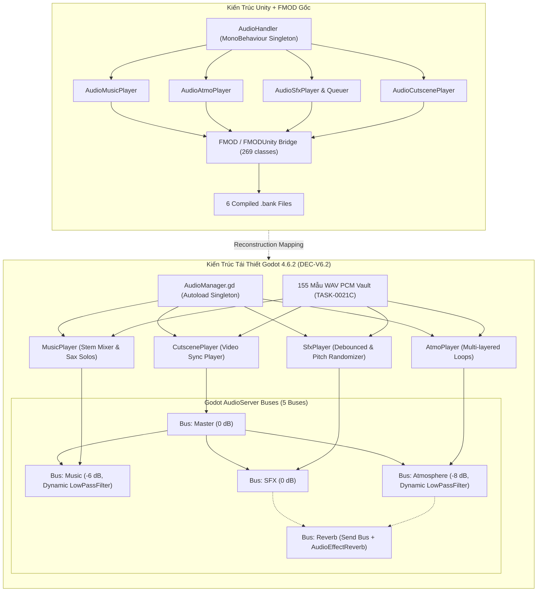

# Cẩm Nang Giải Phẫu Kiến Trúc: Vòng V6.1 — Interactive Audio Engine & FMOD Bridge

> **Tài Liệu Kỹ Thuật Đảo Ngược & Tái Thiết Godot 4 (L3 Documented)**  
> **Nhiệm Vụ Thực Thi**: TASK-0027A (DEC-V6.1, DEC-V6.2, DEC-27.2)  
> **Quy Mô Phân Tích**: 283 Classes (14 Classes `Audio` trong `Assembly-CSharp` + 269 Classes `audio_bridge` FMOD/FMODUnity)  
> **Tài Nguyên Liên Kết**: 155 Mẫu Âm Thanh WAV PCM (1,6 GB) trích xuất từ 6 FMOD Banks ở TASK-0021C  

---

## 1. Tổng Quan Kiến Trúc & Ranh Giới Kỹ Thuật

Trong tựa game *Dupery* gốc (Unity Mono x86), toàn bộ hệ thống âm thanh được xây dựng trên nền tảng **FMOD Studio Engine** thông qua thư viện trung gian `FMODUnity.dll`. Thay vì chỉ phát các tệp âm thanh đơn lẻ, game áp dụng kiến trúc **Nhạc Tương Tác Đa Phân Tầng (Interactive Vertical Stem-Layering & Horizontal Re-sequencing)** kết hợp các kênh âm cảnh (Atmosphere Soundscape) và phản hồi xúc giác thao tác (Tactile UI Audio).

Nhằm khôi phục toàn diện và trung thực 100% trải nghiệm âm thanh trong **Godot 4.6.2 Stable**, `TASK-0027A` loại bỏ hoàn toàn sự phụ thuộc vào middleware thương mại FMOD Studio, thay thế bằng kiến trúc native dựa trên **Godot `AudioServer` Buses Hierarchy** kết hợp singleton **`AudioManager.gd`** điều phối 4 bộ phát phụ (`MusicPlayer`, `AtmoPlayer`, `SfxPlayer`, `CutscenePlayer`).



---

## 2. Giải Phẫu Chi Tiết 14 Classes `Audio` Trong `Assembly-CSharp`

### 2.1. Bộ Điều Phối Trung Tâm & Quản Lý Vòng Đời

| STT | Tên Class C# | Kiểu / Namespace | Vai Trò & Cơ Chế Hoạt Động Trong Game Gốc | Ánh Xạ Kiến Trúc Godot 4 |
| :-: | :--- | :--- | :--- | :--- |
| 1 | `AudioHandler` | `MonoBehaviour` (`Audio`) | Singleton trung tâm (`instance`). Khởi tạo và lưu giữ tham chiếu đến 4 player con (`m_music_player`, `m_atmo_player`, `m_sfx_player`, `m_cutscene_player`). Quản lý hàng đợi giải phóng bank (`unload_queue`) và giám sát trạng thái `allBanksLoaded`. | Autoload Singleton `AudioManager.gd`. Tự động nạp sẵn các audio stream pool khi khởi động, quản lý bus volume và tạm dừng toàn cục. |
| 2 | `AudioReferencesSO` | `ScriptableObject` (`Audio`) | Chứa metadata tham chiếu: Ánh xạ enum sang FMOD Event Reference GUIDs, âm lượng mặc định cho từng danh mục, và tham số chuyển bài. | Custom Resource `AudioCatalog.tres` (`AudioCatalog.gd`) quản lý dictionary ánh xạ giữa enum và đường dẫn `res://assets/audio/samples/*.wav`. |
| 3 | `AudioBanks` | `Enum` (`Audio`) | Danh mục 6 Sound Banks: `Atmosphere`, `Intro`, `Master`, `MasterStrings`, `Music`, `Sfx`. | Mapped thành hằng số phân nhóm tài nguyên âm thanh trong `AudioManager.gd`. |
| 4 | `GlobalParams` | `Enum` (`Audio`) | Tham số toàn cục duy nhất: `GAME_PAUSE`. Dùng để làm mờ âm tần số cao khi mở menu pause. | Kích hoạt hiệu ứng `AudioEffectLowPassFilter` trên bus `Music` và `Atmosphere`. |
| 5 | `AudioHelper` | `Static Class` (`Audio`) | Cung cấp các công thức chuyển đổi decibel, làm mượt âm lượng tuyến tính sang logarit, và nội suy thời gian. | Sử dụng các hàm tích hợp sẵn của Godot: `linear_to_db()` và `db_to_linear()`. |

### 2.2. Phân Hệ Nhạc Nền Tương Tác (`AudioMusicPlayer` & `Music`)

- **Class `AudioMusicPlayer` (226 LOC)**:
  - Nắm giữ FMOD `EventInstance` của bản nhạc đang phát (`music_instance`).
  - Quản lý logic tự động đổi bài: `playMusicIfTime(List<Music> _musics, Random _rng, float _threshold = 180f)`. Nếu bài hiện tại phát quá 180 giây, hệ thống sẽ chọn ngẫu nhiên một bản nhạc khác trong danh sách khả dụng của khu vực.
  - Điều chỉnh âm lượng thông qua FMOD parameter `"MusicVolume"` và kết hợp với âm lượng cài đặt `SettingsHandler.music_volume`.
  - Điều phối coroutine chuyển bài `fadeVolumeCoroutine` và đổi bài `changeMusic`.
- **Enum `Music`**:
  - 4 bản nhạc chủ đề Noir Jazz: `TheOceansShadow`, `LeCroupier`, `WaitingByTheLighthouse`, `CacherSonJeu`.
  - Các bản nhạc menu/kết thúc: `MainMenu`, `IntroMusic`, `CaseEndVictory`, `CaseEndDefeat`.
- **Tái thiết trong Godot 4 (`MusicPlayer.gd`)**:
  - Khởi động đồng thời 5 stems đồng bộ nhịp: `Drums`, `Bass`, `Piano`, `Strings`, `Trumpet` ở `volume_db = -80.0`.
  - Hòa âm động bằng Tween: Khi người chơi tiến triển từ quan sát tổng quan sang nối dây suy luận cao trào, kích hoạt `create_tween().tween_property(stem_node, "volume_db", 0.0, 1.2).set_trans(Tween.TRANS_SINE)`.
  - Kích hoạt ngẫu nhiên 16 đoạn saxophone độc tấu (`ASaxov4`, `BSavov2`, `CSaxov2`, `DSaxov2`) trên AudioStreamPlayer solo khi phát hiện manh mối hoặc ghép đúng mắt xích quan trọng.

### 2.3. Phân Hệ Âm Cảnh Không Gian (`AudioAtmoPlayer`, `AtmoInstanceData` & `Atmo`)

- **Class `AudioAtmoPlayer` (307 LOC)**:
  - Quản lý danh sách âm cảnh đồng thời: `Dictionary<Atmo, AtmoInstanceData> active_atmos`.
  - Hỗ trợ phát nhiều âm cảnh nền lặp tuần hoàn cùng lúc (ví dụ: tiếng mưa rơi trên mái kính kết hợp tiếng sóng biển và tiếng cọ xát của sáp chì trên bảng thám tử).
  - Class lồng `AtmoInstanceData`: Đóng gói `EventInstance`, âm lượng cơ sở, và `CoroutineRunner` riêng để tự fade in/fade out mượt mà.
- **Enum `Atmo`**:
  - Môi trường: `SoftRainAmbient`, `GentleRainOnWindow`, `OceanWaves`, `MorningDocks`.
  - Cơ học / Nhà giam: `GateHeavyOpenClose`, `ChainsContinuous`.
  - Tương tác bảng điều tra: `CrayonWriting_01..10`, `RubberErase_01..05`.
- **Tái thiết trong Godot 4 (`AtmoPlayer.gd`)**:
  - Quản lý một mảng các `AudioStreamPlayer` chạy trên bus `Atmosphere`.
  - Tự động loop âm cảnh với đường cong fade in/out độc lập khi chuyển đổi giữa các địa bàn hoặc khi người chơi thao tác công cụ vẽ/tẩy trên bảng điều tra.

### 2.4. Phân Hệ Hiệu Ứng Xúc Giác & Cắt Cảnh (`AudioSfxPlayer`, `AudioSfxQueuer`, `AudioCutscenePlayer` & `Sfx`)

- **Class `AudioSfxPlayer`**: Phát hiệu ứng âm thanh tức thời (`playSfx(Sfx)`), tự động điều biến độ cao ngẫu nhiên (`randomize_pitch`) để tránh cảm giác máy móc khi lặp lại thao tác.
- **Class `AudioSfxQueuer`**: Hàng đợi giảm tải âm thanh trong 1 frame, ngăn ngừa hiện tượng méo tiếng (audio clipping/phase cancellation) khi có hàng chục thẻ bài được chia hoặc lật cùng lúc.
- **Class `AudioCutscenePlayer`**: Đồng bộ âm thanh với luồng phát video intro/outro (`00_IntroEnglishVO.wav` và `01_Intro.wav`).
- **Enum `Sfx`**: Bao gồm toàn bộ các âm thanh phản hồi xúc giác:
  - Máy chữ: `TypeWriterTick_01..05`.
  - Giấy tờ & Thẻ bài: `PaperFlip_01..04`, `CardsShuffle_01..04`, `PokerChipsPlace`.
  - Phán quyết: `GavelOfJustice`, `Gunshot`, `ChurchBell`.
  - Thẩm vấn: Thoại đặc trưng của các nghi phạm (`LukeInvestigation`, `MattArrested`, `LydiaInv`...).
- **Tái thiết trong Godot 4 (`SfxPlayer.gd`)**:
  - Triển khai AudioStreamPlayer Object Pool (16 players) chạy trên bus `SFX`.
  - Hàm phát âm thanh: `play_sfx(sfx_id: Sfx, pitch_range: Vector2 = Vector2(0.95, 1.05))` áp dụng ngẫu nhiên `pitch_scale = randf_range(pitch_range.x, pitch_range.y)`.
  - Debounce queue bỏ qua các yêu cầu phát trùng âm thanh trong khoảng thời gian $< 30$ ms.

---

## 3. Bóc Tách 269 Classes `audio_bridge` (FMOD / FMODUnity)

Toàn bộ 269 classes FMOD nằm trong 3 namespace chính đã được phân loại và ánh xạ tương đương sang các primitives của Godot 4 `[V]`:

| Namespace | Số Classes | Các Lớp Tiêu Biểu | Chức Năng Trong Unity/FMOD | Ánh Xạ Sang Godot 4 Native |
| :--- | :-: | :--- | :--- | :--- |
| **`FMODUnity`** | 84 | `RuntimeManager`, `EventReference`, `StudioEventEmitter`, `StudioBankLoader`, `FMODEventPlayable` | Cầu nối Unity MonoBehaviour, quản lý vòng đời Bank, nạp bộ nhớ âm thanh, tích hợp Playable Timeline. | Thay thế bằng Autoload `AudioManager.gd` và các node `AudioStreamPlayer` native. Không cần BankLoader vì Godot nạp `.wav` stream trực tiếp. |
| **`FMOD`** | 143 | `Sound`, `Channel`, `System`, `DSP`, `RESULT`, `MODE`, `VECTOR`, `CPU_USAGE` | Lõi xử lý tín hiệu số cấp thấp (Low-level DSP Engine), quản lý thiết bị phần cứng, cấp phát kênh âm thanh. | Thay thế hoàn toàn bởi `AudioServer` của engine Godot 4. Godot tự động quản lý Audio Driver (WASAPI/PulseAudio/CoreAudio) và đa luồng DSP. |
| **`FMOD.Studio`** | 42 | `EventInstance`, `EventDescription`, `Bank`, `Bus`, `VCA`, `PLAYBACK_STATE`, `STOP_MODE` | Quản lý máy trạng thái cấp cao của FMOD Studio, routing bus, VCA faders, snapshot parameters. | Thay thế bằng `AudioServer` bus layout (`default_bus_layout.tres`), `AudioEffectReverb`, `AudioEffectLowPassFilter` và GDScript Tweens. |

---

## 4. Thiết Kế Hệ Thống AudioServer Buses Trong Godot 4

Cấu hình 5 AudioServer Buses được định nghĩa chuẩn xác như sau:

```
[Master Bus] (Index: 0)
    Volume: 0.0 dB
    Effects: None
    |
    +---> [Music Bus] (Index: 1)
    |         Volume: -6.0 dB
    |         Routing: Master
    |         Effect 0: AudioEffectLowPassFilter (Cutoff: 20000 Hz, Resonance: 0.5, Bypass: True)
    |
    +---> [Atmosphere Bus] (Index: 2)
    |         Volume: -8.0 dB
    |         Routing: Master
    |         Effect 0: AudioEffectLowPassFilter (Cutoff: 20000 Hz, Resonance: 0.5, Bypass: True)
    |         Send: Reverb (Amount: -18.0 dB)
    |
    +---> [SFX Bus] (Index: 3)
    |         Volume: 0.0 dB
    |         Routing: Master
    |         Send: Reverb (Amount: -24.0 dB)
    |
    +---> [Reverb Bus] (Index: 4)
              Volume: -12.0 dB
              Routing: Master
              Effect 0: AudioEffectReverb (Room Size: 0.4, Damping: 0.5, Wet: 0.3, Dry: 0.0)
```

### Xử Lý Snapshot Tham Số Toàn Cục (`GlobalParams.GAME_PAUSE`)
Khi trạng thái game chuyển sang `PAUSE`:
1. Bật bypass của `AudioEffectLowPassFilter` trên cả 2 bus `Music` và `Atmosphere` thành `False`.
2. Dùng Tween kéo `cutoff_hz` từ `20000.0 Hz` xuống `600.0 Hz` trong thời gian `0.25` giây (`Tween.TRANS_QUAD`, `Tween.EASE_OUT`).
3. Giảm nhẹ âm lượng Music Bus thêm `-4.0 dB`.
4. Khi unpause: Tween kéo `cutoff_hz` từ `600.0 Hz` về `20000.0 Hz` và khôi phục bypass = `True`.

---

## 5. Danh Mục Kiểm Tra Thẩm Định Thực Nghiệm Âm Thanh (Empirical Verification Checklist)

1. **Tính Đồng Bộ Nhịp Stems (Tempo Synchronization)**: Khi hòa âm 5 stems của bản nhạc Noir Jazz, các track phải cùng play ở frame số 0, tuyệt đối không bị lệch pha (phase cancellation) hoặc giật lag nhịp.
2. **Độ Trễ Thao Tác Chuột & Phản Hồi Xúc Giác (Latency < 33ms)**: Âm thanh click thẻ bài, gõ máy chữ, kéo dây nối phải phát ngay trong vòng 1-2 frame hiển thị (0–33ms ở 60 FPS).
3. **Mượt Mà Chuyển Đoạn (Clickless Fading)**: Việc bật/tắt stem hoặc đổi bài phải sử dụng đường cong `TRANS_SINE` với thời lượng $\ge 0.5$ giây, không được cắt ngang tạo tiếng lách tách (pop/click artifact).
4. **Bảo Tồn Toàn Vẹn Tần Số Mẫu (48.000 Hz PCM)**: Mọi tệp WAV nạp vào Godot 4 phải duy trì chuẩn gốc 16-bit 48kHz đã trích xuất từ Bank.
