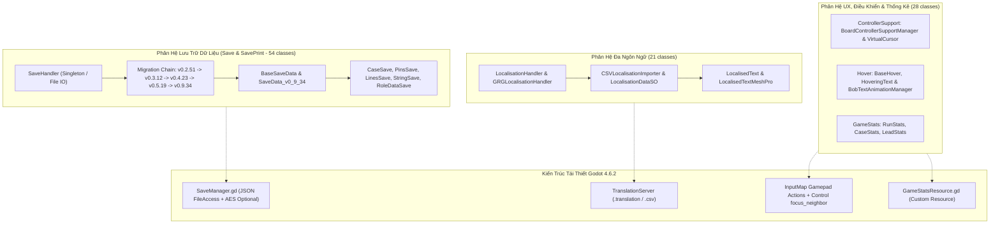

# Cẩm Nang Giải Phẫu Kiến Trúc: Vòng V6.2 — Persistence, Localization & UX Infrastructure

> **Tài Liệu Kỹ Thuật Đảo Ngược & Tái Thiết Godot 4 (L3 Documented)**  
> **Nhiệm Vụ Thực Thi**: TASK-0027B (DEC-V6.1, DEC-V6.3, DEC-V6.4)  
> **Quy Mô Phân Tích**: 103 Classes (Save 51, SavePrint 3, Localisation 3, GRGLocalisation 18, Hover 11, ControllerSupport 10, GameStats 7)  
> **Mục Tiêu**: Hoàn tất 100% Vòng V6 (386/386 classes) và nâng lũy kế toàn dự án lên 1.302 classes L3 documented  

---

## 1. Tổng Quan Kiến Trúc Hạ Tầng Kỹ Thuật

Trong tựa game *Dupery*, các hệ thống hạ tầng kỹ thuật đóng vai trò xương sống hỗ trợ toàn bộ vòng lặp điều tra:
1. **Lưu trữ & Khôi phục trạng thái (Persistence & Save Migration)**: Quản lý tính bền vững của hồ sơ vụ án, vị trí các ghim/dây nối, tiến trình mở khóa địa bàn và chỉ số danh tiếng. Đặc biệt, hệ thống sở hữu chuỗi nâng cấp phiên bản tự động (Version Migration Chain) trải dài từ `v0_2_51` đến `v0_9_34`.
2. **Bản địa hóa đa ngôn ngữ (Localization)**: Cung cấp cơ chế dịch thuật động trên toàn bộ giao diện bảng thám tử, đối thoại nghi phạm, và báo cáo kết án.
3. **Phản hồi xúc giác trực quan (Hover & Tooltips)**: Xử lý hiệu ứng lơ lửng (hovering text/image), nhấp nháy nhịp tim (bobbing text), và liên kết từ khóa (text link keywords).
4. **Hỗ trợ Bộ điều khiển (Controller Support & Virtual Cursor)**: Cho phép trải nghiệm game trọn vẹn bằng tay cầm (Gamepad) thông qua con trỏ ảo và cơ chế tự động hít (snap) giữa các ghim thẻ bài.
5. **Thống kê chuyên sâu (Game Stats)**: Ghi nhận chi tiết từng chỉ số hiệu năng phá án theo 4 địa bàn.

---

## 2. Giải Phẫu Phân Hệ Lưu Trữ Dữ Liệu (`Save` & `SavePrint` — 54 Classes)

### 2.1. Quản Lý Vòng Đời & Chuỗi Nâng Cấp Phiên Bản (Version Migration Chain)

| STT | Tên Class C# | Namespace | Vai Trò Trong Game Gốc | Ánh Xạ Kiến Trúc Godot 4 |
| :-: | :--- | :--- | :--- | :--- |
| 1 | `SaveHandler` | `Save` | Quản lý File I/O, đường dẫn thư mục `Application.persistentDataPath`, đọc/ghi JSON thông qua `GRGLib.Save.Json`, kiểm tra tính toàn vẹn phiên bản save. | Autoload `SaveManager.gd`. Sử dụng `FileAccess` đọc/ghi `user://saves/save_{slot}.json`. |
| 2 | `BaseSaveData` | `Save` | Lớp trừu tượng cơ sở cho toàn bộ cấu trúc save game. Chứa biến `reload_scene` và phương thức chuyển đổi `toGameState()`. | Class cơ sở `BaseSaveData.gd`. |
| 3 | `SaveData_v0_9_34` | `Save` | Cấu trúc dữ liệu save hoàn chỉnh mới nhất của game Steam. Đóng gói đầy đủ trạng thái: `run_stats`, `clues`, `tutorial`, `region`, `available_leads`, `current_case`, `pins_data`, `lines_data`, `strings_data`. | Dictionary schema chuẩn trong Godot 4 `SaveDataSchema.gd`. |
| 4-7 | `SaveDatav0_2_51`, `v0_3_12`, `v0_4_23`, `v0_5_19` | `Save` | Các cấu trúc save legacy của các phiên bản cập nhật trước đó trong giai đoạn Early Access. | Pipeline hàm migration tuần tự: `_migrate_v0_2_to_v0_3()`, `_migrate_v0_3_to_v0_4()`, v.v. |
| 8 | `GameSave` | `Save` | Lớp đóng gói một slot save đang nạp trong bộ nhớ, giám sát biến `is_previous_version` và `has_save_data`. | `SaveSlot.gd`. |
| 9 | `SaveDataVersions` | `Save` | Enum định nghĩa các mốc phiên bản save: `INVALID`, `NEWEST`, `V0_2_51`, `V0_3_12`, `V0_4_23`, `V0_6_0`, `V0_9_34`. | Enum `SaveVersion` trong GDScript. |

### 2.2. Các Thực Thể Dữ Liệu Lưu Trữ Thành Phần (Subsystem Payloads)

- **Trực quan Bảng điều tra**:
  - `PinsSave` & `PinSaveData`: Lưu tọa độ pixel `(x, y)` của từng ghim thẻ bài nghi phạm trên bảng gỗ.
  - `LinesSave` & `LineSaveData`: Lưu các đường kẻ nối giữa các thẻ bài.
  - `StringSave` & `StringSaveData`: Lưu màu sắc, hai đầu mút và độ chùng võng của từng sợi dây len nối án.
- **Tiến trình Vụ án & Manh mối**:
  - `CaseSave`, `CaseBuildDataSave`, `CaseRewardSave`: Lưu mã vụ án, các ràng buộc thế hệ, và phần thưởng danh tiếng tương ứng.
  - `LeadSaveData`, `LeadEventSaveData`, `LeadProgressionManagerCustomSave`: Lưu các mắt xích đầu mối đang mở.
  - `RoleDataSave`, `RoleInfoSave`, `RoleSave`: Lưu các vai trò nghi phạm đã được nhận diện.
- **Phân hệ SavePrint (3 classes)**:
  - `BugReportImporter`, `SimulatedBoardManager`, `SimulatedBoardTile`: Công cụ nội bộ của nhà phát triển cho phép nạp một chuỗi save string để tái hiện nguyên trạng bảng điều tra nhằm điều tra lỗi (bug triage). Trong Godot 4, tích hợp thành tiện ích Debug Inspector.

---

## 3. Giải Phẫu Phân Hệ Đa Ngôn Ngữ (`Localisation` & `GRGLocalisation` — 21 Classes)

Phân hệ bao gồm 3 classes cấp cao trong `Assembly-CSharp` và 18 classes trong DLL độc lập `gildedrunegames.grglocalisation`:

| Nhóm | Tên Class | Vai Trò & Cơ Chế | Giải Pháp Godot 4 Native |
| :--- | :--- | :--- | :--- |
| **Cấp Cao** | `LocalisationHandler`, `LocalisationHelper`, `LanguageSettings` | Tự động lấy ngôn ngữ mặc định từ Steam API (`SteamUtils.GetSteamUILanguage()`), quản lý font chữ tương ứng cho từng ngôn ngữ (`language_fonts`). | Kết nối `TranslationServer.get_locale()` và ánh xạ font bộ gõ UTF-8 động. |
| **Thư Viện Lõi** | `GRGLocalisationHandler`, `LanguageKey`, `Languages` | Singleton điều phối từ điển ngôn ngữ. Enum `Languages` hỗ trợ các thứ tiếng chính thức. | Sử dụng hệ thống bản địa hóa native của Godot (`Project Settings -> Localization`). |
| **Nạp & Phân Tích** | `CSVLocalisationImporter`, `LocalisationDataSO`, `LocalisationDictionary` | Phân tích tệp `.csv` chứa các cột `Key, English, French, German...` và nạp vào ScriptableObject. | Godot 4 tự động import trực tiếp các tệp `.csv` sang binary `.translation` files. |
| **UI Tương Thích** | `LocalisedText`, `LocalisedTextMeshPro`, `LocalisedImage`, `LocalisedAudio` | Tự động cập nhật nội dung Text / Sprite / AudioClip khi có sự kiện `onLanguageChange`. | Tận dụng cơ chế tự động dịch của các Control nodes (`Label`, `Button`, `RichTextLabel`) qua hàm `tr("KEY")`. |

---

## 4. Giải Phẫu Phân Hệ Tương Tác & Phản Hồi Trực Quan (`Hover` — 11 Classes)

Hệ thống cung cấp phản hồi trực quan sống động khi người chơi di chuột qua các thành phần trên bảng điều tra:
- `BaseHover`: Lớp cơ sở trừu tượng quản lý coroutine mờ dần (`fade_runner`) và kiểm tra cờ khóa (`is_locked`).
- `BobTextAnimationManager`: Tạo hiệu ứng chữ nhấp nhô nhẹ theo thời gian (dùng hàm $\sin(t \cdot \omega)$) nhằm thu hút sự chú ý vào các thông điệp cảnh báo hoặc ghim quan trọng.
- `HoveringText` & `HoveringImage`: Hiển thị khung popup tooltip nổi trên bề mặt bảng gỗ, tự căn chỉnh vị trí để không bị tràn ra ngoài màn hình.
- `TextLinkHover` & `TextLinksHandler`: Phát hiện các liên kết từ khóa trong đoạn văn bản hồ sơ nghi phạm (Rich Text Links), hiển thị định nghĩa mở rộng khi hover.
- **Tái thiết trong Godot 4**:
  - Triển khai `CustomTooltip.tscn` kế thừa `PanelContainer`.
  - Hiệu ứng bobbing thực hiện bằng Tween tuần hoàn (`create_tween().set_loops().tween_property(self, "position:y", ...)`).
  - RichTextLabel hỗ trợ sẵn `meta_hover_started` và `meta_hover_ended` thay thế hoàn toàn `TextLinksHandler`.

---

## 5. Giải Phẫu Phân Hệ Hỗ Trợ Bộ Điều Khiển (`ControllerSupport` — 10 Classes)

Cung cấp khả năng chơi game bằng tay cầm (Xbox / PlayStation / Switch Pro Controller):
- `AdvancedInputHandler` & `BaseInputHandler`: Lắng nghe tín hiệu analog stick và D-pad.
- `BoardControllerSupportManager`: Quản lý con trỏ ảo (Virtual Cursor) trên bảng thám tử. Khi người chơi gạt cần analog, con trỏ di chuyển tự do; khi nhấn D-pad, con trỏ tự động nhảy (snap) đến ghim (Pin) hoặc thẻ bài gần nhất theo hướng chỉ định.
- `CaseControllerSupportHandler`, `CaseSelectionInputHandler`, `LineupInputHandler`: Xử lý điều khiển trong các màn hình chuyên biệt (lựa chọn vụ án, hàng ngũ thẩm vấn).
- **Tái thiết trong Godot 4**:
  - Đăng ký các action chuẩn trong `InputMap`: `board_cursor_move`, `board_snap_pin`, `board_connect_string`, `board_place_pin`.
  - Sử dụng thuật toán dò khoảng cách Euclidean để tìm node `Control` gần nhất khi người chơi nhấn D-pad hướng tương ứng.

---

## 6. Giải Phẫu Phân Hệ Thống Kê Chỉ Số Game (`GameStats` — 7 Classes)

Theo dõi toàn diện quá trình điều tra của người chơi:
- `RunStats`: Thống kê tổng của toàn bộ lượt chơi (tổng thời gian, tổng số tiền, tổng số vụ án thành công/thất bại).
- `CaseStats`: Thống kê chi tiết từng vụ án (số manh mối tìm thấy, số lần đoán sai, độ chính xác phán quyết).
- `LeadStats`: Thống kê hiệu quả khai thác đầu mối.
- `OfficeCaseStats`, `DocksCaseStats`, `CasinoCaseStats`, `CombinedCaseStats`: Phân loại thống kê theo đặc thù 4 địa bàn.
- **Tái thiết trong Godot 4**:
  - Đóng gói trong Custom Resource `GameStatsData.gd`.
  - Tự động serialize vào cấu trúc JSON save game khi kết thúc vụ án hoặc thoát game.

---

## 7. Danh Mục Kiểm Tra Thẩm Định Thực Nghiệm (Empirical Verification Checklist)

1. **Chuỗi Nâng Cấp Save Tự Động (Migration Continuity)**: Nạp một save file mẫu định dạng `v0_2_51`, hệ thống phải nâng cấp liên tục qua các version trung gian và xuất ra đúng schema `SaveData_v0_9_34` mà không mất mát dữ liệu ghim/dây.
2. **Bảo Toàn Tọa Độ Ghim & Dây Nối (Pixel Precision)**: Tọa độ các ghim và dây nối sau khi lưu và nạp lại phải khớp chính xác tuyệt đối so với trước khi lưu.
3. **Chuyển Đổi Ngôn Ngữ Tức Thời (Hot Language Swap)**: Khi đổi ngôn ngữ trong cài đặt, toàn bộ nhãn chữ và tooltip phải cập nhật ngay trong cùng frame mà không cần khởi động lại game.
4. **Độ Trễ Phản Hồi Con Trỏ Ảo (Controller Latency < 16ms)**: Tín hiệu từ analog stick tay cầm phải phản ánh mượt mà lên tọa độ con trỏ ảo trong vòng 1 frame (60 FPS).
