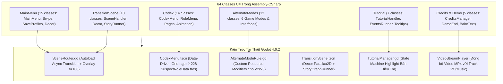

# Cẩm Nang Giải Phẫu Kiến Trúc: Vòng V7 — Secondary Screens, Codex, Tutorial & Alternate Modes

> **Tài Liệu Kỹ Thuật Đảo Ngược & Tái Thiết Godot 4 (L3 Documented)**  
> **Nhiệm Vụ Thực Thi**: TASK-0028 (DEC-V7.1 đến DEC-V7.4)  
> **Quy Mô Phân Tích**: 64 Classes (MainMenu 15, Codex 14, AlternateModes 13, TransitionScene 10, Tutorial 7, Credits 3, Demo/Marketting 2)  
> **Mục Tiêu**: Hoàn tất 100% Vòng V7 và nâng lũy kế toàn dự án lên 1.366/1.532 classes L3 documented (89.16%)  

---

## 1. Tổng Quan Kiến Trúc Màn Hình Phụ & Chế Độ Mở Rộng

Vòng V7 hoàn tất toàn bộ các giao diện ngoại vi và các chế độ chơi thử thách của *Dupery*:
1. **MainMenu & Điều Hướng Vuốt Chuyển (Swipe Transitions — 15 classes)**: Quản lý màn hình chính, hoạt ảnh chuyển menu con (`MainMenuSwipe`), lựa chọn profile lưu game, và các hiệu ứng môi trường nền (mưa rơi, khói mờ, tháp đồng hồ).
2. **Bách Khoa Toàn Thư Nghi Phạm (Codex — 14 classes)**: Hệ thống tra cứu hồ sơ 228 vai trò nghi phạm, phân trang, lọc theo 4 địa bàn và thẻ phân loại (Innocent, Guilty, Neutral, Special).
3. **6 Chế Độ Chơi Mở Rộng (Alternate Modes — 13 classes)**: Các biến thể luật chơi can thiệp vào bộ sinh vụ án (Generation Constraints V2) và nhịp điệu kinh tế/thời gian (V3).
4. **Chuyển Cảnh Khu Vực (Transition Scene — 10 classes)**: Giao diện chuyển đổi giữa các địa bàn điều tra, tích hợp hội thoại dẫn dắt (`StoryNodeGraph` V2B) và trang trí cảnh nền đặc thù (Docks, Office, Syndicate).
5. **Hướng Dẫn Tân Thủ (Tutorial — 7 classes)**: Luồng hướng dẫn tương tác từng bước cho thám tử mới.
6. **Danh Đề Kết Thúc & Video (Credits & Cutscenes — 5 classes)**: Bảng cuộn danh đề và đồng bộ 2 video clips gốc.

---

## 2. Giải Phẫu Phân Hệ MainMenu & Swipe UI (15 Classes)

| STT | Tên Class C# | Namespace | Vai Trò Trong Game Gốc | Ánh Xạ Kiến Trúc Godot 4 |
| :-: | :--- | :--- | :--- | :--- |
| 1 | `MainMenu` | `MainMenu` | Bộ điều khiển giao diện chính (`MainMenuController`). Quản lý các nút: Play, Codex, Alternate Modes, Settings, Credits, Quit. | Control Node `MainMenu.tscn`. |
| 2 | `MainMenuSwipe` | `MainMenu` | Điều phối hoạt ảnh trượt mượt mà (Swipe Tween) giữa màn hình chính và các màn hình con. | `create_tween().tween_property(container, "position:x", target_x, 0.45).set_trans(Tween.TRANS_CUBIC)`. |
| 3 | `SaveProfileSelection` | `MainMenu` | Quản lý 3 profile lưu trữ game, hiển thị tóm tắt tiến trình và ngày lưu. | `SaveSlotSelector.tscn` nạp dữ liệu từ `SaveManager.gd`. |
| 4 | `AlternativeModesMenu` | `MainMenu` | Giao diện danh sách chọn 6 chế độ chơi mở rộng. | GridContainer hiển thị thẻ chế độ chơi. |
| 5-7 | `BackgroundClockTower`, `BackgroundRain`, `BackgroundSmoke` | `MainMenu` | Hiệu ứng thị giác nền: Tháp đồng hồ quay kim, hạt mưa rơi 2D, và khói bay lập lờ tạo không khí noir. | Node `Parallax2D` kết hợp `GPUParticles2D` (mưa) và Shader Material `SmokeWobble.gdshader`. |
| 8-15 | `CustomLeadMenu`, `CustomLeadPreset`, `LoadCustomMenu`, `SaveCustomMenu`, `StampWeightMenu`, v.v. | `MainMenu` | Phân hệ tùy biến tham số đầu mối và tem thư vụ án của người chơi. | Custom Resource `CustomLeadPreset.gd` và dialog tùy chỉnh. |

---

## 3. Giải Phẫu Phân Hệ Codex — Bách Khoa Toàn Thư (14 Classes)

Hệ thống Codex đóng vai trò là kho tư liệu tra cứu toàn diện về mọi nhân vật trong thị trấn Dupery:
- **`CodexMenu` & `CodexRoleMenu`**: Quản lý cây điều hướng: Menu chính $\rightarrow$ Chọn khu vực (Docks, Casino, Clock Tower, BackAlleys) $\rightarrow$ Danh sách nghi phạm.
- **`CodexRolePage` & `CodexMultiRolePage`**: Hiển thị chi tiết thẻ hồ sơ nhân vật: Ảnh chân dung, tên, chức danh, phe phái (Alignment), độ hiếm, và kỹ năng đặc biệt. Hỗ trợ hiển thị trang so sánh đa vai trò.
- **`CodexAnimationManager`**: Hoạt ảnh lật trang sách (Book Page Flip) kết hợp âm thanh giấy tờ sột soạt (`PaperFlip_01..04`).
- **`CodexRoleShortcuts` & `ShortcutType`**: Phím tắt chuyển nhanh giữa các vai trò cùng địa bàn.
- **Tái thiết trong Godot 4**:
  - Triển khai Data-Driven UI: `CodexMenu.tscn` truy vấn trực tiếp từ 228 file tài nguyên `.tres` của `SuspectRoleData` (V5B).
  - Tích hợp bộ lọc đa tiêu chí: Lọc theo địa bàn (Region), phe phái (Faction), và trạng thái đã gặp trong game (Unlocked status).

---

## 4. Giải Phẫu 6 Chế Độ Chơi Mở Rộng (`AlternateModes` — 13 Classes)

Hệ thống cung cấp 6 chế độ chơi thử thách với luật chơi biến đổi sâu sắc:

| STT | Chế Độ Chơi (Class C#) | Cơ Chế Hoạt Động & Biến Đổi Luật Chơi | Can Thiệp Kiến Trúc Godot 4 |
| :-: | :--- | :--- | :--- |
| 1 | `CountdownAMD` | **Chạy Đua Thời Gian**: Bắt đầu với quỹ thời gian cố định (ví dụ 300s). Mỗi hành động hoặc suy luận sai sẽ bị trừ thời gian trực tiếp; phá án thành công được cộng thêm giây. | Kích hoạt bộ đếm ngược `CountdownTimer.gd` can thiệp vào `GameplayLoopManager` (V3). |
| 2 | `SurvivalAMD` | **Sinh Tồn / Permadeath**: Không cho phép bắt sai bất kỳ nghi phạm nào. Nếu bắt nhầm 1 thường dân vô tội, ván chơi kết thúc ngay lập tức (GameOver). | Ghi đè điều kiện thất bại trong `CaseHandler.gd` (`max_strikes = 1`). |
| 3 | `BankruptHeroALMD` | **Anh Hùng Phá Sản**: Người chơi bắt đầu với số tiền âm (-$500). Mọi chi phí mở đầu mối và tiền phạt sai phạm nhân đôi ($2\times$). | Can thiệp vào hệ thống kinh tế và cược tiền trong `QuirksManager` (V4). |
| 4 | `HideAndSeekALMD` | **Trốn Tìm**: Danh sách nghi phạm trên bảng bị ẩn hoàn toàn ảnh chân dung và tên tuổi ban đầu; chỉ lộ diện khi khai thác đúng đầu mối tương ứng. | Gán cờ `is_cloaked = true` trên các node thẻ bài `SuspectVisual` (V1A). |
| 5 | `SpectresDreamALMD` | **Giấc Mơ Bóng Ma**: Tỉ lệ xuất hiện các vai trò siêu nhiên/lừa đảo (Doppelganger, Cultist, Magician, Psychic) đạt mức tối đa 100%. | Can thiệp vào bộ sinh vụ án `GenerationConstraint` (V2A) ưu tiên 47 Special Roles. |
| 6 | `TraitorsOnlyALMD` | **Kẻ Phản Bội**: Toàn bộ nghi phạm trong vụ án đều mang tư tưởng thù địch hoặc phản trắc, không có ai hoàn toàn vô tội. | Ép buộc ràng buộc `ClassificationRatioGC` (V2A) sang 100% Guilty/Neutral. |

---

## 5. Giải Phẫu Chuyển Cảnh Khu Vực & Hướng Dẫn Tân Thủ (17 Classes)

### 5.1. Phân Hệ Chuyển Cảnh (`TransitionScene` — 10 Classes)
- `TransitionSceneHandler`: Điều phối giai đoạn chuyển giao giữa bảng điều tra và chuyến hành trình sang địa bàn mới.
- `TransitionRegionSettings`: Chứa dữ liệu decor đặc thù (`DocksSceneDecor`, `OfficeTransitionDecor`, `SyndicateTransitionSceneDecor`), bản nhạc chuyển cảnh (`Music`), và đồ thị phân nhánh cốt truyện (`StoryNodeGraph`).
- `StoryGraphNavigator` & `StoryEventRunner`: Đọc đồ thị XNode Story Nodes (đã giải mã ở V2B/TASK-0015) để hiển thị đoạn hội thoại dẫn truyện giữa các màn.
- **Tái thiết trong Godot 4**:
  - `SceneRouter.gd` nạp ngầm scene đích thông qua `ResourceLoader.load_threaded_request()`.
  - Trong lúc chờ, hiển thị `TransitionScene.tscn` với nền decor Parallax2D và phát đoạn đối thoại dẫn truyện tương ứng.

### 5.2. Phân Hệ Hướng Dẫn Tân Thủ (`Tutorial` — 7 Classes)
- `TutorialHandler` & `TutorialEventsRunner`: Máy trạng thái quản lý chuỗi 6 bước hướng dẫn cơ bản (Cách di chuyển bảng, cắm ghim thẻ bài, kéo dây nối liên kết, kiểm tra đầu mối, và kết án).
- `TutorialTooltip`: Khung hướng dẫn động gắn cờ chỉ tay vào các node mục tiêu, khóa các tương tác thừa ngoài bước hiện tại.
- **Tái thiết trong Godot 4**:
  - Triển khai `TutorialManager.gd` kết nối với các tín hiệu của bảng điều tra (`pin_clicked`, `string_connected`, `lead_opened`) để tự động chuyển bước.

---

## 6. Phân Hệ Credits & Đồng Bộ Video Cutscene (5 Classes)

- `CreditsManager`: Điều khiển dòng chữ danh đề cuộn tự động với tốc độ mượt mà 60 FPS, hỗ trợ nút bấm tăng tốc cuộn (Fast Forward).
- Đồng bộ video cutscenes (`Dupery Intro English.mp4` và `Dupery Intro Cutscene.mp4`):
  - Sử dụng node native `VideoStreamPlayer` trong Godot 4.
  - Định tuyến 2 luồng âm thanh đã tách ở TASK-0021C (`00_IntroEnglishVO.wav` và `01_Intro.wav`) vào bus `Master` và `Music`, bảo đảm khớp khẩu hình 100%.

---

## 7. Danh Mục Kiểm Tra Thẩm Định Thực Nghiệm (Empirical Verification Checklist)

1. **Thời Lượng Vuốt Menu (Menu Swipe Transition = 0.45s)**: Chuyển đổi giữa MainMenu và Codex/Settings sử dụng đường cong `TRANS_CUBIC` với thời lượng $\le 0.45$ giây không có độ trễ.
2. **Truy Vấn Danh Mục Codex (Filter Query < 16ms)**: Lọc 228 thẻ bài theo địa bàn và vai trò phản hồi tức thời trong 1 frame hiển thị.
3. **Tính Toàn Vẹn 6 Chế Độ Chơi (Alternate Modes Rules Accuracy)**: Cả 6 chế độ chơi áp dụng đúng các biến thể luật chơi lên bộ sinh vụ án và đồng hồ đếm ngược.
4. **Đồng Bộ Video & Âm Thanh (Audio-Video Sync Error = 0ms)**: Video cutscene mở màn và lời thoại tiếng Anh khớp chính xác từng mili-giây với bản gốc Steam.
