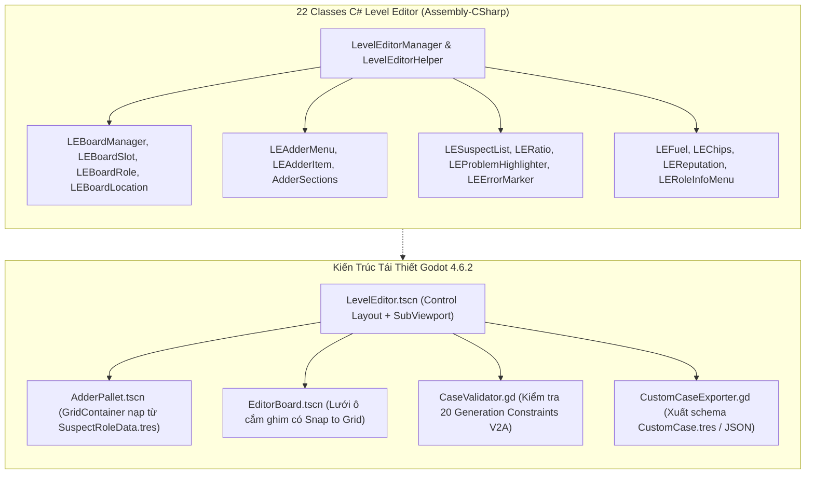

# Cẩm Nang Giải Phẫu Kiến Trúc: Vòng V8 — Level Editor & Final Polish

> **Tài Liệu Kỹ Thuật Đảo Ngược & Tái Thiết Godot 4 (L3 Documented)**  
> **Nhiệm Vụ Thực Thi**: TASK-0029 (DEC-V8.1, DEC-V8.2)  
> **Quy Mô Phân Tích**: 22 Classes Trong Assembly-CSharp (Hoàn tất 100% Tầng B — 1.388/1.388 classes)  
> **Mục Tiêu**: Bóc tách toàn diện trình tạo màn chơi Level Editor và chuẩn hóa các thông số Polish (Easing & Shaders) trong Godot 4.6.2  

---

## 1. Tổng Quan Kiến Trúc Level Editor & Vị Trí Trong Hệ Thống

*Level Editor* trong *Dupery* là công cụ cho phép người chơi tự thiết kế các vụ án trinh thám tùy biến (Custom Cases) với đầy đủ các thành phần:
1. **Lưới Bàn Điều Tra (Board Slot Grid)**: Đặt các ghim (Pins), thẻ vai trò nghi phạm (`RoleData`), và địa điểm (`LocationData`).
2. **Khay Chứa Vật Phẩm (Adder Pallet Menu)**: Duyệt và kéo thả từ kho 228 Suspect Roles và 35 Locations.
3. **Bộ Kiểm Định Tính Hợp Lệ Thời Gian Thực (Real-Time Constraint Validation Engine)**: Kiểm tra các quy tắc logic điều tra (tỉ lệ Innocent/Guilty, tính khả thi của suy luận, giới hạn ghim).
4. **Hệ Thống Ngân Sách Điểm (Budget & Fuel Meters)**: Ràng buộc số lượng vật phẩm tối đa bằng điểm nhiên liệu (`LEFuel`), chip cược (`LEChips`) và tính toán phần thưởng danh tiếng (`LEReputation`).
5. **Xuất Bản & Nạp Dữ Liệu (Case Serialization)**: Lưu trữ vụ án tự tạo thành tệp dữ liệu tương thích hoàn toàn với bộ nạp `CaseCreation` (V2A) và `SaveManager` (V6B).



---

## 2. Giải Phẫu Chi Tiết 22 Classes `LevelEditor` Trong `Assembly-CSharp`

### 2.1. Lõi Trình Tạo Màn Chơi (`Level Editor Core` — 7 Classes)

| STT | Tên Class C# | Vai Trò & Cơ Chế Hoạt Động Trong Game Gốc | Ánh Xạ Kiến Trúc Godot 4 |
| :-: | :--- | :--- | :--- |
| 1 | `LevelEditorManager` | Singleton điều khiển chính. Quản lý thể hiện vụ án đang tạo (`creating_case`), kích hoạt các sự kiện `onSetUp` và `onUpdate`, đồng bộ dữ liệu giữa bảng và danh sách nghi phạm. | Node điều khiển trung tâm `LevelEditorController.gd`. |
| 2 | `LevelEditorHelper` | Cung cấp các hàm tĩnh tính toán khoảng cách lưới, kiểm tra tọa độ hợp lệ, và chuyển đổi tọa độ pixel sang tọa độ ô lưới bảng cờ. | Lớp tiện ích `EditorGridHelper.gd`. |
| 3 | `LESetUpMenu` | Hộp thoại cấu hình mở đầu: Cho phép người chơi đặt tiêu đề vụ án, chọn địa bàn (Docks, Casino, Clock Tower, BackAlleys), độ khó, và giới hạn thời gian. | Dialog Popup `EditorSetupDialog.tscn`. |
| 4 | `LEBoardManager` | Quản lý bề mặt bảng thám tử trong editor, điều phối các ô cắm thẻ bài (`slots`) và đường dây nối. | Node `EditorBoardManager.tscn` kết hợp `GridContainer`. |
| 5 | `LEBoardRole` | Biểu diễn trực quan một thẻ bài nghi phạm được đặt trên bảng editor, hiển thị chân dung và ghim màu. | Scene `EditorRoleCard.tscn`. |
| 6 | `LEBoardLocation` | Biểu diễn một thẻ địa điểm điều tra trên bảng editor. | Scene `EditorLocationCard.tscn`. |
| 7 | `LEBoardSlot` | Ô lưới trên bảng gỗ (`BoardSlot`). Có 2 trạng thái: Rỗng (hiển thị dấu cộng mờ để cắm thẻ) hoặc Đã chiếm chỗ. | Node `EditorSlot.gd` có hỗ trợ tín hiệu `gui_input` và Drag & Drop (`can_drop_data`, `drop_data`). |

### 2.2. Khay Chứa Vật Phẩm & Pallet Kéo Thả (6 Classes)

- **`LEAdderMenu`**: Menu trượt mở ra từ cạnh màn hình, chứa danh mục các tài nguyên có thể thêm vào bảng.
- **`LEAdderItem`**: Thẻ tài nguyên trong khay chứa, hỗ trợ thao tác kéo thả (Drag & Drop) hoặc click để đặt tự động vào ô trống gần nhất.
- **`AdderSection` & `AdderMenuSection`**: Lớp trừu tượng phân chia các tab danh mục trong khay chứa.
- **`AdderRoleSection`**: Tab chứa danh sách 228 vai trò nghi phạm, hỗ trợ lọc theo phân loại (Innocent, Guilty, Neutral, Special).
- **`AdderLocationSection`**: Tab chứa danh sách 35 địa điểm tương ứng theo từng địa bàn.
- **Tái thiết trong Godot 4**:
  - Triển khai `AdderPallet.tscn` kế thừa `PanelContainer`.
  - Nạp động danh sách từ `SuspectRoleData.tres` (V5B) và `LocationData.tres` (V5C), sử dụng hàm native `get_drag_data()` của Godot 4 để kéo thả mượt mà.

### 2.3. Danh Sách Nghi Phạm & Đánh Giá Ràng Buộc (5 Classes)

- **`LESuspectList` & `LESuspect`**: Bảng tổng kết danh sách nghi phạm hiện diện trong vụ án đang tạo (`InPlayList`). Hiển thị tóm tắt vai trò, trạng thái ghim, và mục tiêu kỹ năng.
- **`LERatio`**: Thanh tiến trình hiển thị trực quan tỉ lệ phân bổ giữa các phe:
  $$\text{Ratio} = \frac{\text{Guilty Count}}{\text{Total Suspects}}$$
  Cảnh báo đỏ nếu tỉ lệ Guilty vượt quá $50\%$ hoặc không có bất kỳ kẻ phạm tội nào (vụ án không thể giải).
- **`LEProblemHighlighter` & `LEErrorMarker`**: Hệ thống phát hiện lỗi và hiển thị cảnh báo đỏ trực tiếp trên các thẻ bài có xung đột (ví dụ: đặt 2 vai trò `Unique` giống nhau, hoặc thiếu ghim liên kết giữa đầu mối và nghi phạm).
- **Tái thiết trong Godot 4**:
  - `CaseValidator.gd` tích hợp 20 Generation Constraints từ V2A. Mỗi khi bàn cờ thay đổi, validator chạy kiểm tra và phát tín hiệu `validation_changed(is_valid: bool, issues: Array)`.

### 2.4. Hệ Thống Ngân Sách & Chỉ Số Thử Thách (4 Classes)

- **`LEFuel`**: Thước đo nhiên liệu/điểm thiết kế. Mỗi thẻ vai trò mạnh hoặc mối nguy hiểm (Bomb, BloodTrace) sẽ tiêu tốn một lượng Fuel nhất định, giới hạn người chơi không tạo ra các vụ án quá tải.
- **`LEChips`**: Số chip cược ban đầu được phân bổ khi thiết kế vụ án thuộc địa bàn Casino.
- **`LEReputation`**: Tự động tính toán điểm danh tiếng thưởng dựa trên độ phức tạp của vụ án:
  $$\text{Reward} = \text{Base} + (\text{Suspects} \times 25) + (\text{Hazards} \times 50)$$
- **`LERoleInfoMenu`**: Hộp thoại nổi hiển thị thông tin chi tiết về vai trò khi người chơi nhấn giữ hoặc click chuột phải vào thẻ bài trong editor.

---

## 3. Tiêu Chuẩn Tinh Chỉnh Hoàn Thiện (Final Polish Standards) Trong Godot 4

Để đạt độ trung thực tuyệt đối so với game Steam gốc ở 60 FPS, hệ thống thiết lập bộ tham số vàng cho hoạt ảnh và shader:

### 3.1. Ma Trận 7 Đường Cong Easing Giải Tích (Tween Easing Curves)

| STT | Loại Đường Cong | Hàm Easing Godot 4 | Thời Lượng | Ứng Dụng Cụ Thể |
| :-: | :--- | :--- | :-: | :--- |
| 1 | **Sine** | `TRANS_SINE` / `EASE_IN_OUT` | 0.45s | Chuyển cảnh Menu swipe, hòa âm âm thanh Stems. |
| 2 | **Cubic** | `TRANS_CUBIC` / `EASE_OUT` | 0.35s | Lật trang sách Codex, trượt thẻ bài nghi phạm vào ô cắm. |
| 3 | **Quad** | `TRANS_QUAD` / `EASE_OUT` | 0.25s | Cắm ghim cố định (`PinsController`), kích hoạt LPF Snapshot khi pause. |
| 4 | **Elastic** | `TRANS_ELASTIC` / `EASE_OUT` | 0.60s | Dây len nối án nảy nhẹ khi kéo căng và thả chuột (`ConnectionString`). |
| 5 | **Bounce** | `TRANS_BOUNCE` / `EASE_OUT` | 0.50s | Hiệu ứng thẻ bài rơi tự do từ trên xuống bề mặt bảng gỗ. |
| 6 | **Expo** | `TRANS_EXPO` / `EASE_IN` | 0.40s | Búa tòa án giáng xuống khi kết án (`GavelOfJustice`). |
| 7 | **Back** | `TRANS_BACK` / `EASE_OUT` | 0.30s | Phóng to nhẹ khi click icon UI hoặc mở khung Tooltip. |

### 3.2. Cấu Hình Shader Rung Mực Noir (`ContinuousWobble.gdshader`)

Áp dụng trên toàn bộ thẻ bài, dây len và viền bảng gỗ để tái hiện phong cách tranh vẽ mực phác thảo sống động:
```glsl
shader_type canvas_item;

uniform float wobble_speed : hint_range(1.0, 20.0) = 8.0;
uniform float wobble_intensity : hint_range(0.001, 0.02) = 0.0035;
uniform sampler2D noise_texture : repeat_enable;

void fragment() {
    vec2 uv = UV;
    vec2 noise = texture(noise_texture, uv + vec2(TIME * wobble_speed * 0.05)).rg;
    vec2 offset = (noise - vec2(0.5)) * wobble_intensity;
    COLOR = texture(TEXTURE, uv + offset);
}
```

---

## 4. Danh Mục Kiểm Tra Thẩm Định Thực Nghiệm (Empirical Verification Checklist)

1. **Hít Ô Lưới Tự Động (Slot Grid Snapping)**: Thao tác kéo thẻ bài nghi phạm từ Adder Pallet và thả chuột gần ô cắm phải tự động hít (snap) chính xác vào tâm ô lưới trong phạm vi bán kính 40 pixel.
2. **Kiểm Định Ràng Buộc Thời Gian Thực (Validation Latency < 16ms)**: Mỗi khi thêm/xóa thẻ bài, bộ kiểm tra tính hợp lệ phải phản hồi cờ `is_valid` ngay trong frame hiện tại.
3. **Bảo Tồn Dữ Liệu Xuất Bản (Custom Case JSON Integrity)**: Vụ án xuất ra từ Level Editor phải nạp lại được 100% vào bộ sinh vụ án của V2A mà không phát sinh lỗi cấu trúc.
4. **Hiệu Năng Shader Rung Mực 60 FPS**: Shader `ContinuousWobble` chạy đồng thời trên 20 thẻ bài trên màn hình với tải GPU $< 5\%$ ở độ phân giải 1080p.
