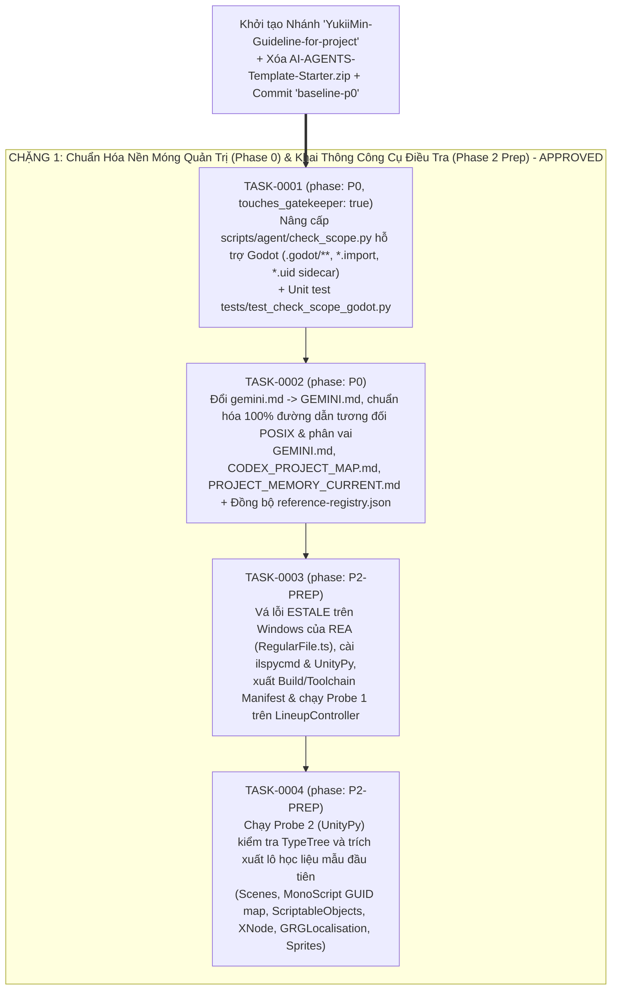
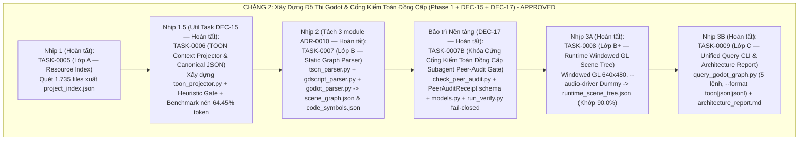

# Kế Hoạch Triển Khai Chi Tiết Từng Bước (v3.0): Nhánh `YukiiMin-Guideline-for-project` & Phân Rã `TASK-XXXX` Trong Từng Chặng

> **Căn cứ Kiến trúc**: [khung_master_plan_3_phase.md](file:///C:/Users/Admin/.gemini/antigravity/brain/5dc69d25-94eb-4e8a-9589-1420dc32d526/khung_master_plan_3_phase.md) (`SPEC-META-PLAN-001` v3.0)  
> **Nhánh Phát triển Độc lập**: `YukiiMin-Guideline-for-project` (Nhánh `main` được khóa bảo toàn tại commit `b35e27e` `[V]`)  
> **Cơ chế Thực thi**: Mỗi Chặng được chia nhỏ thành các Hợp đồng **`TASK-XXXX.md`** nguyên tử; thực thi từng Task một (`ready` $\rightarrow$ độc lập kiểm toán đồng cấp qua Subagent Peer-Audit $\rightarrow$ `run_verify.py` $\rightarrow$ `verified` $\rightarrow$ người dùng duyệt `approved`).

---

## 1. Chính Sách Quản Lý Nhánh Git & Baseline (`DEC-10`)

1. **Bảo toàn tuyệt đối nhánh `main`**:
   - Nhánh `main` giữ nguyên trạng thái gốc tại commit `b35e27e` (`[V]`).
   - Toàn bộ thay đổi và mọi Task phát triển đều nằm trên nhánh **`YukiiMin-Guideline-for-project`** `[V]`.
2. **Khởi tạo Commit Nền móng `baseline-p0` (Theo [`ADR-0008`](file:///D:/Minh/For_myself/my_own_tool/Than_Trung_2/docs/agent-system/decisions/ADR-0008-bootstrap-exception-and-gatekeeper-recursion.md))**:
   - Xóa file nén thừa `AI-AGENTS-Template-Starter.zip`.
   - Đưa toàn bộ trạng thái working tree vào commit nền móng `baseline-p0` trên nhánh `YukiiMin-Guideline-for-project` để working tree sạch `100%` trước khi bắt đầu `TASK-0001` (`[V]`).
   - Trong `TASK-0002`, quy tắc Auto-Push trong `GEMINI.md` được chuẩn hóa thành `git push -u origin YukiiMin-Guideline-for-project` (`[V]`).

---

## 2. CHẶNG 1: Chuẩn Hóa Nền Móng Quản Trị (Phase 0) & Khai Thông Công Cụ Điều Tra (Phase 2 Prep) — [ĐÃ HOÀN TẤT `100%`]

### Chi Tiết 4 Task Nguyên Tử Của Chặng 1:

| Mã Task | Phase | Mục Tiêu Cụ Thể (`goal`) | Phạm Vi Cho Phép (`in_scope`) | Lệnh Kiểm Chứng Tất Định (`verification_commands`) | Trạng Thái & Commit |
| :--- | :--- | :--- | :--- | :--- | :--- |
| **`TASK-0001`** | `P0` | Nâng cấp `check_scope.py` (Nhịp `0.2a`): miễn trừ `.godot/**`, `**/*.import` và tự động hợp lệ hóa file sidecar `<file>.uid` khi `<file>` nằm trong `in_scope`. | `scripts/agent/check_scope.py`, `tests/test_check_scope_godot.py` | `python -m unittest discover -s tests -p "test_*.py"` | **`approved`** (`948c263`) `[V]` |
| **`TASK-0002`** | `P0` | Đổi `gemini.md` $\rightarrow$ `GEMINI.md` (cập nhật nhánh `YukiiMin-Guideline-for-project`), chuẩn hóa 100% đường dẫn tương đối POSIX cho `GEMINI.md`, `CODEX_PROJECT_MAP.md`, `PROJECT_MEMORY_CURRENT.md` và đồng bộ `reference-registry.json`. | `GEMINI.md`, `gemini.md`, `PROJECT_MEMORY_CURRENT.md`, `Than_Tham_Nua_Voi_Godot/CODEX_PROJECT_MAP.md`, `docs/agent-system/reference-registry.json` | `python scripts/agent/validate_registry.py` | **`approved`** (`c75a1d4`) `[V]` |
| **`TASK-0003`** | `P2-PREP` | Vá lỗi Windows `ESTALE` của REA (`RegularFile.ts`), cài `ilspycmd` + `UnityPy` + `pefile`, lập `dupery_build_manifest.json`, `dupery_build_classification.md`, `dupery_toolchain_manifest.json` và chạy **Probe 1 (`LineupController`)**. | `docs/agent-system/evidence/dupery/dupery_build_manifest.json`, `docs/agent-system/evidence/dupery/dupery_build_classification.md`, `docs/agent-system/evidence/dupery/dupery_toolchain_manifest.json`, `docs/agent-system/evidence/dupery/probes/probe1_lineup_controller.json` | `python scripts/agent/verify_dupery_p2_prep.py --task TASK-0003` | **`approved`** (`a8e61bf`) `[V]` |
| **`TASK-0004`** | `P2-PREP` | Chạy **Probe 2 (`UnityPy` Asset Extraction)** trên `Dupery_Data` để kiểm tra TypeTree và trích xuất danh mục Scene, bảng `MonoScript` GUID $\rightarrow$ Type, mẫu `ScriptableObject`, `XNode`, `GRGLocalisation` và `Sprite` thẻ bài. | `scripts/agent/dupery_asset_probe.py`, `docs/agent-system/evidence/dupery/dupery_asset_topology.json`, `docs/agent-system/evidence/dupery/extracted_assets_preview/**` | `python scripts/agent/dupery_asset_probe.py --verify` | **`approved`** (`96b7f08`) `[V]` |

---

## 3. CHẶNG 2: Xây Dựng Đồ Thị Godot 4 & Tối Ưu Hóa Ngữ Cảnh TOON (Phase 1 + DEC-15 + DEC-17) — [ĐÃ HOÀN TẤT `100%`]

### Chi Tiết Kỹ Thuật 6 Hợp Đồng Đã Nghiệm Thu Của Chặng 2:

| Mã Task | Nhịp | Mục Tiêu Kỹ Thuật (`goal`) | Phạm Vi Cho Phép (`in_scope`) | Lệnh Kiểm Chứng (`verification_commands`) | Trạng Thái & Commit |
| :--- | :--- | :--- | :--- | :--- | :--- |
| **`TASK-0005`** | **Nhịp 1** | Xây dựng `scripts/agent/godot_indexer.py`: quét toàn bộ file trong `Than_Tham_Nua_Voi_Godot/`, thống kê phân loại theo tầng, đo LOC GDScript và xuất [`project_index.json`](file:///D:/Minh/For_myself/my_own_tool/Than_Trung_2/docs/agent-system/evidence/godot/project_index.json) (1.735 files, 293 scripts, 81.442 LOC, phát hiện 11 God-files $\ge 1.000$ LOC). | `scripts/agent/godot_indexer.py`, `docs/agent-system/evidence/godot/project_index.json` | `python scripts/agent/godot_indexer.py --verify` | **`approved`** (`534c83e`, `abf1411`) `[V]` |
| **`TASK-0006`** | **Nhịp 1.5 (`DEC-15`)** | Xây dựng `scripts/agent/toon_projector.py` (mã hóa TOON + Per-Array Heuristic Gate 5 tiêu chí + Native Primary Key cột đầu + 1-line Provenance Header), chuẩn hóa `write_canonical_json` và đo thực nghiệm token (giảm 64.45% trên `project_index.json` và 55.90% trên God-files). | `scripts/agent/toon_projector.py`, `scripts/agent/models.py`, `scripts/agent/godot_indexer.py`, `docs/agent-system/evidence/godot/project_index.json`, `tests/test_toon_projector.py` | `python -m unittest tests/test_toon_projector.py` | **`approved`** (`abf1411`, `a184498`) `[V]` |
| **`TASK-0007`** | **Nhịp 2** | Xây dựng bộ Parser đồ thị tĩnh mô-đun hóa 3 tầng theo ADR-0010 (`tscn_parser.py`, `gdscript_parser.py`, `godot_parser.py` đều $<300$ LOC): bóc tách 21 scenes, 1.207 nodes, 405 connections (204 static UI, 201 dynamic code) $\rightarrow$ [`scene_graph.json`](file:///D:/Minh/For_myself/my_own_tool/Than_Trung_2/docs/agent-system/evidence/godot/scene_graph.json) và 4.145 methods $\rightarrow$ [`code_symbols.json`](file:///D:/Minh/For_myself/my_own_tool/Than_Trung_2/docs/agent-system/evidence/godot/code_symbols.json). | `scripts/agent/tscn_parser.py`, `scripts/agent/gdscript_parser.py`, `scripts/agent/godot_parser.py`, `docs/agent-system/evidence/godot/scene_graph.json`, `docs/agent-system/evidence/godot/code_symbols.json`, `tests/test_godot_parser.py` | `python scripts/agent/godot_parser.py --verify` | **`approved`** (`d22b4a4`) `[V]` |
| **`TASK-0007B`** | **Bảo trì (`DEC-17`)** | Thiết lập cơ chế Kiểm toán Đồng cấp Ngữ nghĩa (Semantic Peer-Audit Gate): tạo `scripts/agent/check_peer_audit.py`, tích hợp `PeerAuditReceipt` schema vào `models.py`, sửa link `GEMINI.md` và đồng bộ kích thước build Dupery. Khóa cứng `run_verify.py` fail-closed nếu thiếu kiểm toán đối kháng từ Subagent. | `GEMINI.md`, `docs/agent-system/evidence/dupery/dupery_build_classification.md`, `scripts/agent/models.py`, `scripts/agent/check_scope.py`, `scripts/agent/check_peer_audit.py`, `scripts/agent/run_verify.py`, `tests/test_peer_audit.py` | `python scripts/agent/check_peer_audit.py --task TASK-0007B` | **`approved`** (`2db3262`) `[V]` |
| **`TASK-0008`** | **Nhịp 3A** | Khởi chạy Godot thực tế Windowed GL 640x480 (`--audio-driver Dummy`, tuân thủ Core Guardrail 1 tuyệt đối không dùng `--headless`) qua `RuntimeTreeDump.tscn`, dump 20 nodes sống (/root/ và 3 Autoload singletons `AppVersion`, `AppLogger`, `AppFlow`), đối chiếu với đồ thị tĩnh đạt **`90.0%` correlation confidence** trong [`runtime_static_correlation.json`](file:///D:/Minh/For_myself/my_own_tool/Than_Trung_2/docs/agent-system/evidence/godot/runtime_static_correlation.json). | `scripts/agent/capture_runtime_tree.py`, `Than_Tham_Nua_Voi_Godot/scenes/tools/RuntimeTreeDump.gd`, `Than_Tham_Nua_Voi_Godot/scenes/tools/RuntimeTreeDump.tscn`, `docs/agent-system/evidence/godot/runtime_scene_tree.json`, `docs/agent-system/evidence/godot/runtime_static_correlation.json`, `tests/test_capture_runtime_tree.py` | `python scripts/agent/capture_runtime_tree.py --verify` | **`approved`** (`63357a8`) `[V]` |
| **`TASK-0009`** | **Nhịp 3B** | Đóng gói CLI `scripts/agent/query_godot_graph.py` (202 LOC, tier `ok`) tích hợp 5 lệnh (`find-node`, `find-script`, `trace-connections`, `check-god-files`, `stats`) hỗ trợ `--format toon|json|jsonl`, và xuất bản báo cáo phân tích toàn diện [`architecture_report.md`](file:///D:/Minh/For_myself/my_own_tool/Than_Trung_2/docs/agent-system/evidence/godot/architecture_report.md). | `scripts/agent/query_godot_graph.py`, `docs/agent-system/evidence/godot/architecture_report.md`, `tests/test_query_godot_graph.py` | `python scripts/agent/query_godot_graph.py stats` | **`approved`** (`de37e92`) `[V]` |

---

## 4. CHẶNG 3: Giải Phẫu Toàn Diện 100% Game Gốc *Dupery* (Spec v2.0) — [ĐANG TRIỂN KHAI]

> **Kế hoạch Chi tiết SSOT**: Xem [`PLAN-CHANG-3-DUPERY-RECONSTRUCTION.md`](file:///D:/Minh/For_myself/my_own_tool/Than_Trung_2/docs/agent-system/plans/PLAN-CHANG-3-DUPERY-RECONSTRUCTION.md) (Mã tham chiếu: `PLAN-CHANG-003`).  
> **Tổng cộng 23 Tasks**: `TASK-0010` $\rightarrow$ `TASK-0032` chia thành 3 tầng:
> - **Tầng A (Nền tảng, TASK-0010..0021)**: Decompile 4+1 assemblies, Obligation Ledger (L1–L4, Tier 1/2), TypeTree Gate (DEC-22, blocking), Project Settings (11 managers), 12 scenes (GameObject, RectTransform, Inspector), ScriptableObjects & XNode graphs, Sprite/Font Vault, Materials/Shaders, FMOD sample extraction, Golden Reference Capture (TASK-0019, human-in-the-loop), Runtime Probe (TASK-0020, spike go/no-go), CLI `query_dupery_graph.py`.
> - **Tầng B (Vòng giải phẫu V1–V8, TASK-0022..0029)**: V1 Bảng thám tử, V2 Sinh vụ án, V3 Vòng chơi, V4 Vật phẩm/Quirks, V5 Roles, V6 Hạ tầng/Save, V7 Menu/Tutorial, V8 LevelEditor.
> - **Tầng C (Kiểm toán & Cẩm nang, TASK-0030..0032)**: Coverage audit, Bách khoa Unity $\rightarrow$ Godot 4.6.2, Cross-project mapping & REA live lookup recipes.

---

## 5. CHẶNG 4: Áp Dụng Chuyển Giao — Phục Hồi Thuật Toán, Tái Cấu Trúc Godot & Kiến Trúc Nền Mạng LAN Multiplayer (TASK-0033 đến TASK-0041)

> **Căn cứ Thống nhất qua `/grill-me`**: Xem chi tiết tại [quy_hoach_toan_dien_chang_4_va_chang_extra.md](file:///C:/Users/Admin/.gemini/antigravity/brain/5dc69d25-94eb-4e8a-9589-1420dc32d526/quy_hoach_toan_dien_chang_4_va_chang_extra.md) (`SPEC-MASTER-BLUEPRINT-P3`).  
> **Tổng cộng 9 Tasks**: Chia làm 2 giai đoạn chiến lược:
> - **Giai đoạn 4A: Chuẩn Hóa Nền Tảng & Tái Thiết Cốt Lõi Single-Player**:
>   - `TASK-0033`: Phase 0 Gatekeeper Upgrade Nhịp 0.2b (`check_line_budget.py` `baseline_exemptions`, `.gd` support, trần 800/1000 LOC per ADR-0010 DEC-AMEND-01).
>   - `TASK-0034`: Pilot DO-02 CaseGenerator Rewrite (`DotNetRandom.gd` Knuth subtractive generator, 20 Generation Constraints từ V2A, Fuzz Test 1.000 hạt giống cam kết 100% nghiệm duy nhất).
>   - `TASK-0035`: Pilot DO-05 Detective Board & Suspect Card Clean Rebuild (Canvas 1920x1080 pixel-snap, nạp 879 sprites gốc, ghim chỉ dây Catenary2D, sửa dứt điểm lỗi mất chữ font 5px và tràn icon).
>   - `TASK-0036`: Pilot DO-03 Case Selection System & Level Progression (Chọn 1 trong 3 câu đố từ V1/V3, lưu tiến trình vượt màn dạng Candy Crush / Angry Birds).
>   - `TASK-0037`: Pilot DO-01/04 Looting & Shop Screen Redesign (Cơ chế `ItemFanManager` xòe quạt thẻ bài từ V4, không gian thoáng đãng trực quan, tách `AuctionCatalog.gd` sang `Custom Resource .tres`).
> - **Giai đoạn 4B: Xây Dựng Kiến Trúc Nền Mạng LAN Multiplayer & Mở Rộng 2 Mode Mới (PvP & PvBot)**:
>   - `TASK-0038`: Network Foundation & UDP LAN Discovery (`NetworkManager.gd` Autoload, `ENetMultiplayerPeer`, beacon port 8910 tìm phòng tự động qua WiFi + Direct IP connect fallback).
>   - `TASK-0039`: Lobby Room UI & Slot Allocation (Giao diện Tạo phòng, danh sách phòng WiFi 1-chạm, quản lý Slot người chơi Human và Slot Bot AI với 3 mức độ Dễ/Vừa/Khó).
>   - `TASK-0040`: RPC Action Bridges & Secret Bidding Network Hooks (Khung giao tiếp Client-Server gửi nhận action realtime, cơ chế Đấu Giá Ẩn bảo mật giữa các client).
>   - `TASK-0041`: Tổng Kiểm Tra Tích Hợp Cuối Cùng Chặng 4 (Chạy song song 2 tiến trình Godot trong mạng nội bộ kiểm tra kết nối, đối chiếu SceneTree sống không dùng `--headless`, nghiệm thu toàn diện Chặng 4).

---

## 6. CHẶNG EXTRA (CHẶNG 5): Hệ Sinh Thái Nâng Cao & Đạt Chuẩn Parity 100% So Với Game Gốc Steam (TASK-0042 đến TASK-0047)

> **Mục tiêu**: Đưa toàn bộ các hệ sinh thái cao cấp của Dupery gốc vào Godot Fan-Game Thần Trùng sau khi Chặng 4 hoàn thành, bảo đảm đạt độ hoàn thiện 100% như game thương mại trên Steam:
> - **`TASK-0042`**: Interactive Noir Jazz Audio Engine (FMOD-Style 5 Buses, stem fading 4 lớp, 16 sax solo riffs kích hoạt khi nối đúng manh mối).
> - **`TASK-0043`**: Lineup Police Accusation Cinematic Scene (Màn hình kết tội nghi phạm dàn hàng cảnh sát, đèn chiếu spotlight, hoạt ảnh còng tay kịch tính).
> - **`TASK-0044`**: Suspect Abilities Engine & Role Extensibility (Di trú 171 classes V5A, khung gắn kỹ năng bị động/chủ động cho nhân vật Thần Trùng).
> - **`TASK-0045`**: In-Game Codex Encyclopedia (Bách khoa toàn thư trong game: tra cứu hồ sơ nhân vật, tiểu sử, phân tích tâm lý).
> - **`TASK-0046`**: 6 Alternate Game Modes (Draft Mode, Endless Mode, Speedrun đếm ngược, Hardcore, Custom Seed, Daily Case từ V7).
> - **`TASK-0047`**: Level Editor & Custom Case Sharing (Trình tạo màn chơi tùy biến, grid placement, fuel meter, xuất nhập JSON từ V8).
