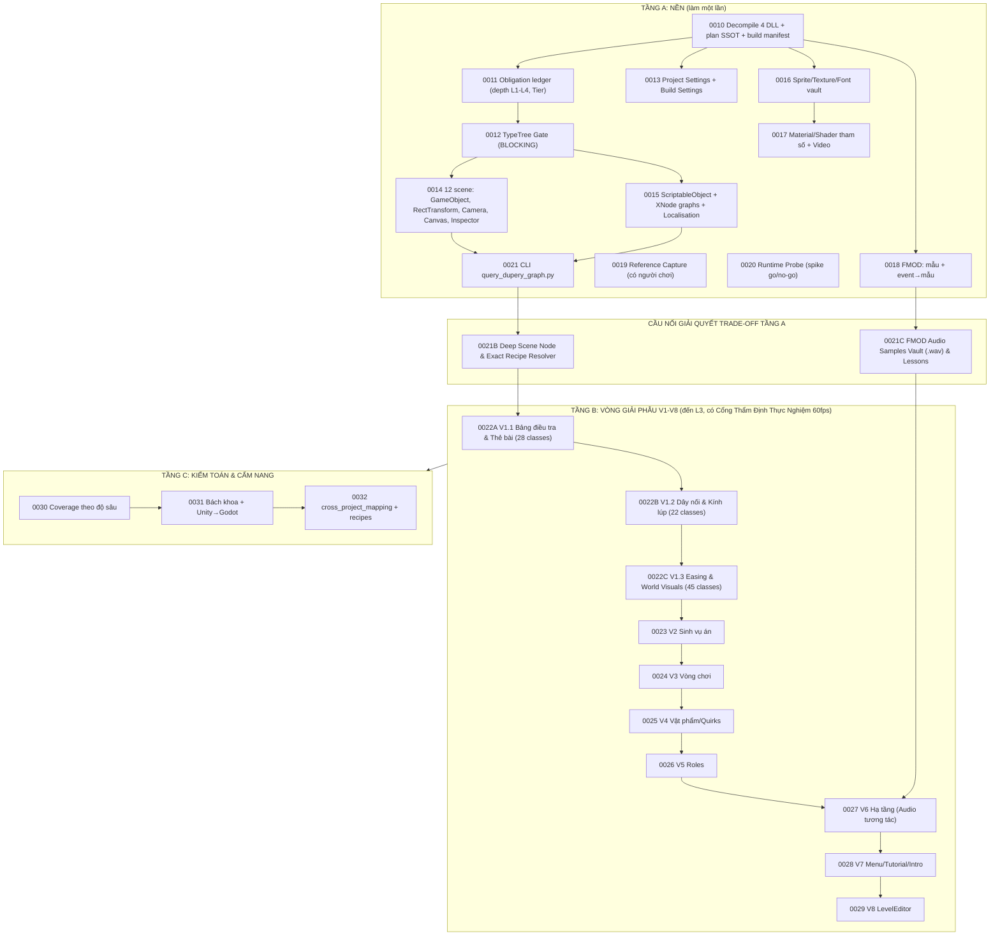

# Kế Hoạch Chi Tiết Chặng 3 (Spec v2.2): Giải Phẫu Toàn Diện Game Gốc *Dupery*

> **Mã tài liệu**: `PLAN-CHANG-3-DUPERY-RECONSTRUCTION` v2.2  
> **Trạng thái**: APPROVED bởi người dùng (2026-10-21). Bắt đầu thực thi từ `TASK-0010`.  
> **Đối tượng**: bản dựng *Dupery* (Unity `2022.3.62f3`, Mono CIL, PE32 x86) `[V]`  
> **Nguồn phản biện**: nhận định bên ngoài (Claude) + thực nghiệm đối chiếu trong phiên này (mục 1).  

---

## 1. Kết Quả Phản Biện (Gate 1–3) và Bằng Chứng Thực Nghiệm

### 1.1. Probe chỉ-đọc đã chạy trong phiên này
Hai script scratch (`scratch/probe_dupery_depth.py`, `probe_dupery_monobehaviour.py`, `probe_dupery_script_ptr.py`) chạy trên `Dupery_Data`. Đây là **Tool Gap** (script chưa đăng ký, không phải engine pass); kết quả chỉ dùng để định hướng plan, và sẽ được thay bằng script có đăng ký ở `TASK-0012`.

| # | Phát hiện | Nhãn | Hệ quả cho plan |
| :-- | :--- | :-: | :--- |
| P1 | `globalgamemanagers` chứa đủ 12 manager: `PlayerSettings`, `TagManager`, `Physics2DSettings`, `PhysicsManager`, `QualitySettings`, `GraphicsSettings`, `TimeManager`, `InputManager`, `BuildSettings`, `AudioManager`, `ResourceManager`; **cả 11 đọc được bằng `read_typetree()`** | `[V]` | Bổ sung task Project Settings (rẻ, chắc chắn) |
| P2 | Histogram toàn bộ `globalgamemanagers*`, `resources.assets`, `sharedassets0-11`, `level0-11`: **0 `AnimationClip`, 0 `Animator`/`AnimatorController`, 0 `ParticleSystem`**. Có: `Material` 54, `Shader` 46, `Font` 10, `Sprite` 879, `Texture2D` 752, `VideoClip` 2, `Camera` 24, `Canvas` 24, `MonoBehaviour` 11.952 | `[V]` | Task "Animation/Animator/Particle" của đề xuất ngoài **không có đối tượng để trích**. Chuyển động nằm trong code (`GRGLib.Coroutines.CoroutineLibrary`) nên Behaviour Capture quan trọng hơn |
| P3 | `MonoBehaviour` đọc bằng `obj.read()`: **11.519/11.953 (96,4%) lỗi** `ValueError: Expected to read 13972 bytes, but only read 44 bytes`. Nguyên nhân: TypeTree nhúng trong file chỉ chứa phần base (44 byte), thiếu trường do class C# định nghĩa | `[V]` (nguyên nhân: `[I]`) | **Điểm nghẽn lớn nhất**. Inspector của scene, `ScriptableObject` (`Quirks`, `CaseFile`, Localisation), đồ thị `XNode`, Light2D/Volume (đều là `MonoBehaviour`) **chưa đọc được**. Thêm `TypeTree Gate` bắt buộc (DEC-22) |
| P4 | `TypeTreeGenerator` có sẵn trong UnityPy 1.25.4; `TypeTreeGeneratorAPI` **chưa cài**. `AssetStudio v0.16.47` + `Mono.Cecil.dll` có sẵn ở `D:\Minh\Tool_App\` | `[V]` | Có thang phương án dự phòng không cần cài phần mềm lớn (mục DEC-22) |
| P5 | `Dupery.exe` sections: `.text .rdata .data .rsrc .reloc` (không có section kiểu stub DRM) | `[V]` (khả năng hook: `[U]`) | Runtime Probe có cơ sở thử, vẫn phải làm spike go/no-go |
| P6 | `ilspycmd -l c`, tách type lồng nhau theo tiền tố: `Assembly-CSharp` = **917 listed = 890 top-level + 27 nested**; `GRGLib` = 100 listed (98 top-level); `XNode.dll` = 21 listed (9 top-level) | `[V]` (phương pháp tách nested: `[I]`) | **Số liệu v1 sai**: v1 ghi "929 classes" và các nhóm `Visual 73`, `CaseCreation 11`, `Save 46`, `LevelEditor 20`, `Codex 15`, `Audio 9`. Số đo lại: `Visual 68 + Visual.Drawing 4`, `CaseCreation 8`, `Save 45`, `LevelEditor 17`, `Codex 13`, `Audio 8`, `Quirks 59`, `Nodes 39 + Nodes.Logic 18 = 57`. Nguyên nhân v1: gom theo `split('.')[0]`, lẫn type lồng vào namespace |
| P7 | "53 XNode.Node" (master plan) vs "57 class Nodes": **khác đơn vị** (53 = số instance trong đồ thị; 57 = số class node). Chưa đối chiếu được vì P3 chặn việc đếm instance | `[I]` | Không phải mâu thuẫn; kiểm chứng ở `TASK-0012` |
| P8 | `dupery_asset_topology.json` (TASK-0004) báo 208 sprite; quét đầy đủ cho **879** | `[V]` | Số liệu TASK-0004 là mẫu một phần, không dùng làm mẫu số coverage |

### 1.2. Những chỗ đồng ý, phản đối, và điều chỉnh
| Nội dung đề xuất ngoài | Quyết định | Lý do |
| :--- | :-: | :--- |
| Thiếu lớp Project Settings, Material/Font, FMOD, Runtime, hành vi nhìn thấy được | **Đồng ý** | Plan v1 chỉ có Camera/URP/FMOD nói chung; không có Runtime hay golden reference |
| Thang độ sâu L1→L4 theo class | **Đồng ý, có sửa** | Giữ thang. L4 (`ported_and_compared`) thuộc chặng Godot, không gate ở Chặng 3 (DEC-21/24) |
| Probe trước khi cam kết TypeTree | **Đồng ý và đã được chứng minh cần thiết** | P3. Chính plan v1 đã giả định đọc được Inspector mà chưa probe |
| Vòng dọc "giải phẫu → dựng Godot → so sánh" nằm trong Chặng 3 | **Phản đối một phần** | Người dùng đã tách: Chặng 3 = hiểu người đi trước, các chặng sau = áp dụng. Gộp port vào Chặng 3 làm mờ ranh giới và đẩy chặng Godot xuống không có chủ đích. Giữ vòng V1–V8 làm đơn vị tổ chức chung, phần port chạy ở Chặng 4+ với cùng mã vòng |
| Task `0012c` Animation/Animator/Particle | **Bác bỏ** | P2: 0 đối tượng. Ghi nhận như phát hiện âm trong ledger; chỉ giữ Material/Shader tham số, Font, VideoClip |
| "UnityPy đọc được, cần thử" cho Inspector/ScriptableObject | **Sửa mức độ chắc chắn** | P3: mặc định không đọc được 96,4% MonoBehaviour |
| Số lượng task nhiều, có đường cắt | **Đồng ý, có sửa** | Giữ đường cắt P0 (mục 4) nhưng đưa `TypeTree Gate` vào P0 vì nhiều task khác phụ thuộc |
| Lấy "53 vs 57" làm việc cần kiểm tra | **Ghi nhận, khác đơn vị** | P7 |
| Tiền đề "Chặng 3 hiện mới đào sâu logic và dữ liệu" | **Không chính xác** | Chưa có task Chặng 3 nào chạy. `ScriptableObject` mới chỉ lấy tên (`m_Name`), chưa lấy dữ liệu |

---

## 2. Quyết Định Kiến Trúc

### Giữ nguyên từ v1
- **DEC-18** — Lưu trữ 2 tầng: mã C# decompile (`generated/decompiled_cs/**`, khớp `**/generated/**` → `role: generated`, `exempt` tại `project-config.json:17`) và JSON/Markdown vào Git; ảnh/âm thanh nặng vào `dupery_datamined_vault/` (git-ignored, có manifest SHA-256 và script bung 1 lệnh).
- **DEC-19** — Cẩm nang định vị động: mỗi phân hệ có `rea_live_lookup_recipe` (tọa độ nguồn + lệnh REA/CLI) để Agent chặng sau nạp context tươi từ bản gốc thay vì tin tài liệu tóm tắt.
- **DEC-20** — Sổ cái nghĩa vụ chống bỏ sót + Subagent Peer-Audit (DEC-17) cho từng task.

### Mới trong v2
- **DEC-21 — Thang độ sâu theo class/asset** (trường `depth` trong ledger):

| Mức | Tên | Nghĩa | Gate ở Chặng 3 |
| :-: | :--- | :--- | :--- |
| L1 | `cataloged` | Có trong ledger kèm tọa độ (token/PathID, đường dẫn `.cs`) | **Mọi** class/scene/asset Tier 1 |
| L2 | `summarized` | Có mô tả vai trò, quan hệ chính, trạng thái đọc/ghi | Mọi nhóm vòng V1–V8 |
| L3 | `algorithm_extracted` | Có thuật toán/hằng số/luồng điều khiển đủ để cài lại | **Nhóm lõi**: V1, V2, V3, V4 và đại diện mỗi nhóm của V5 |
| L4 | `ported_and_compared` | Bản Godot chạy và qua checklist so với golden reference | **Không gate ở Chặng 3**; gate ở chặng Godot tương ứng |

- **DEC-22 — TypeTree Gate (chặn các task phụ thuộc)**: `TASK-0012` phải chốt cách giải mã `MonoBehaviour` trước khi bất kỳ task Inspector/ScriptableObject/XNode nào bắt đầu. Thang phương án, thử theo thứ tự, dừng ở phương án đầu tiên đạt tiêu chí:
  1. `UnityPy` + `TypeTreeGenerator` dùng 4 DLL trong `Managed/` (cần cài `TypeTreeGeneratorAPI`; **đã được người dùng duyệt cài**).
  2. `AssetStudio v0.16.47` đã có trên đĩa: xuất `MonoBehaviour` sang JSON bằng thư mục `Managed/` (`Mono.Cecil`).
  3. `AssetRipper` CLI (**đã được người dùng duyệt cài**).
  - **Tiêu chí đạt**: ≥99% `MonoBehaviour` trong 12 scene giải mã có trường (script tên + giá trị), phần còn lại liệt kê tên + lý do trong `typetree_failures.json`; `XNode` đếm được instance; `ScriptableObject` `Quirks`/`CaseFile` ra đủ trường.
  - **Fail-closed**: nếu cả 3 thất bại, task Inspector/XNode/ScriptableObject bị chặn, báo người dùng; không suy diễn giá trị.
- **DEC-23 — Behaviour Capture là lớp hạng nhất**: vì chuyển động nằm trong code (`CoroutineLibrary`, P2) và shader chỉ có tham số, độ giống phải được đo bằng quan sát: Reference Capture (screenshot/video bản gốc) và Runtime Probe (thứ tự gọi, giá trị tween, cặp seed → vụ án).
- **DEC-24 — Ranh giới Chặng 3**: Chặng 3 kết thúc ở giải phẫu (L1/L2/L3) + golden reference + checklist so sánh. Port sang Godot và L4 chạy ở Chặng 4+ theo mã vòng V1–V8.
- **DEC-25 — LAN ngoài phạm vi Chặng 3**: *Dupery* không có LAN; thiết kế LAN (ENet/MultiplayerAPI của Godot, master plan đã nhắc `ENetMultiplayerPeer`) là chặng thiết kế riêng sau V3. Nếu generator tất định theo seed, LAN chỉ cần đồng bộ seed và hành động (`[I]`, kiểm chứng bằng cặp seed → vụ án từ `TASK-0020`).
- **DEC-26 — Cổng Thẩm Định Thực Nghiệm 60fps (Empirical Validation Gate)**: Áp dụng bắt buộc cho từng vòng V1–V8 ở Tầng B. Khi có video gameplay 60fps do người dùng cung cấp theo `reference_capture_protocol.md` (TASK-0019), mỗi task vòng giải phẫu phải đối chiếu thực nghiệm:
  - *V2 Sinh vụ án*: Chạy seed tương ứng trên engine tái thiết và so sánh kết quả sinh vụ án (nghi phạm, đặc điểm, vị trí) với thực tế trên video, kiểm chứng tính tất định 100%.
  - *V1, V3, V8*: Đo lường đường cong chuyển dịch pixel frame-by-frame 60fps để kiểm chứng 7 công thức Easing và thứ tự coroutine thực tế.
- **DEC-27 — Giải Quyết Triệt Để Các Đánh Đổi Kỹ Thuật Tầng A (Resolving Layer A Trade-Offs)**:
  1. *FMOD Audio Samples Vault Extraction (`TASK-0021C`)*: Dùng công cụ chuyên dụng bung toàn bộ 155 file âm thanh FSB5 ra đĩa dạng `.wav` tại `evidence/dupery/vault/audio/samples/`, lập manifest SHA-256 và tài liệu `fmod_audio_architecture_lessons.md` để người dùng học hỏi và tái sử dụng thực tế (giải quyết triệt để Trade-off 1 của TASK-0018).
  2. *Interactive Audio System Reconstruction (`TASK-0027`)*: Tái thiết hệ thống âm thanh tương tác trong Godot 4 (`AudioServer` buses, dynamic cross-fade curves, ducking, snapshot parameters `/GamePause`, `/SfxParameters/PopPitch`) dựa trên căn chỉnh thực nghiệm từ video gameplay 60fps thực tế thay vì suy diễn thuần lý thuyết (giải quyết triệt để Trade-off 2 của TASK-0018).
  3. *Deep Scene Node Traversal & Exact Dependency Linkage (`TASK-0021B`)*: Xây dựng module `scripts/agent/dupery_graph_resolver.py` duyệt đệ quy 100% toàn bộ 5.279 GameObjects đã lưu trữ tại 12 file `scenes/*.json`, đồng thời bóc tách liên kết chính xác (deterministic code & scene linkage) trong `get-recipe` (quét AST/regex file `.cs` để tìm chính xác lệnh gọi âm thanh FMOD và định vị chính xác GameObject/Scene gắn component đó) thay vì đoán mò theo từ khóa (giải quyết triệt để Trade-off 1 & 2 của TASK-0021).

---

## 3. Cấu Trúc Task (27 task: `TASK-0010` → `TASK-0032` kèm `0021B`, `0021C`, `0022A`, `0022B`, `0022C`)

Quy ước mã: tuần tự 4 chữ số (regex `^TASK-[0-9]{4}[A-Z]?$` chỉ nhận hậu tố chữ **hoa**). Chặng Godot cũ dịch xuống từ `TASK-0033`.

### Tầng A — Nền

| Task | Mục tiêu | Đầu ra (`in_scope` dự kiến) | Kiểm chứng | Phụ thuộc |
| :-: | :--- | :--- | :--- | :--- |
| **0010** | Sync plan này vào `docs/agent-system/plans/` + đăng ký `reference-registry.json`. Build manifest (hash, phiên bản công cụ, bản vá REA kèm diff từ `PATCH-REA-WIN-ESTALE-001`). Decompile 4 DLL (`Assembly-CSharp`, `gildedrunegames.grglib`, `gildedrunegames.grglocalisation`, `XNode`) bằng `ilspycmd` vào `evidence/dupery/generated/decompiled_cs/` | plan, registry, `scripts/agent/dupery_decompile.py`, `generated/decompiled_cs/**`, test | số file `.cs` khớp số type top-level (890/98/…) + `validate_registry.py` | — |
| **0011** | Ledger nghĩa vụ: mọi class (kể cả type lồng, đánh dấu `nested_of`), scene, asset, bank, mỗi mục có `depth` (L1–L4), `tier` (1/2), `vong` (V1–V8), tọa độ (metadata token, đường dẫn `.cs`). Đo lại số liệu P6 bằng metadata thật (không dùng tiền tố tên) | `dupery_code_catalog.json`, `reconstruction_obligation_ledger.json`, `scripts/agent/dupery_code_indexer.py`, test | số class ledger = số type từ metadata; `unaccounted == 0` cho L1 | 0010 |
| **0012** | **TypeTree Gate (DEC-22)**. Thử theo thang, ghi lại từng lần thử (lệnh, phiên bản, kết quả). Chọn decoder, đăng ký script, đo tỉ lệ giải mã, đếm instance `XNode` (giải quyết P7) | `scripts/agent/dupery_typetree_decoder.py`, `evidence/dupery/typetree_gate_report.json`, `typetree_failures.json`, test | ≥99% MonoBehaviour 12 scene giải mã có trường; hoặc fail-closed + báo cáo | 0010 |
| **0013** | Project Settings: thứ tự scene (`BuildSettings`), Layers/Tags/Sorting Layers (`TagManager`), `Physics2D`, `Quality`, `Graphics` (incl. `m_AlwaysIncludedShaders`), `Time`, `Input` (`m_Axes`), `Player` (độ phân giải mặc định, cursor), `Audio` | `scripts/agent/dupery_project_settings.py`, `evidence/dupery/project_settings/*.json`, test | 11/11 manager xuất JSON (P1) | 0010 |
| **0014** | 12 scene: cây `GameObject`, `RectTransform` (anchor, pivot, size, scale), `Camera` (ortho size, clear flags, culling), `Canvas`/`CanvasScaler`, giá trị Inspector của `MonoBehaviour` (**lọc trường mặc định** để JSON gọn); ánh xạ GUID → class C# | `scripts/agent/dupery_scene_inspector.py`, `evidence/dupery/scenes/*.json` | 12/12 scene; tỉ lệ MonoBehaviour có trường khớp báo cáo 0012 | 0012 |
| **0015** | `ScriptableObject` (`CaseFile`, `Quirks`, icon sets, `inputs`, TMP settings…) có **dữ liệu**, 4 đồ thị `XNode` kèm kết nối port, bảng `GRGLocalisation` | `scripts/agent/dupery_data_extractor.py`, `evidence/dupery/data/**` | số `XNode.Node` instance đối chiếu "53" (P7); ngôn ngữ + khóa đếm được | 0012 |
| **0016** | Sprite/Texture2D/Font ra vault: cắt atlas, `rect`, `pivot`, `border` (Nine-Slice), `pixelsPerUnit`; manifest SHA-256 + script bung 1 lệnh; cập nhật `.gitignore` và vùng miễn trừ `check_scope.py` | `scripts/agent/extract_dupery_vault.py`, `dupery_vault_manifest.json`, `.gitignore`, `check_scope.py` | số sprite = 879 (P2) hoặc giải thích chênh; hash khớp | 0010 |
| **0017** | `Material` (54) và `Shader` (46): tên, keyword, thuộc tính; `Font`/TMP; `VideoClip` (2). **Ghi rõ: shader chỉ có tên và tham số, không khôi phục mã nguồn**. Ghi nhận âm tính: 0 `AnimationClip`/`Animator`/`ParticleSystem` (P2) kèm lệnh tái kiểm | `evidence/dupery/materials/*.json`, `negative_findings.json` | số Material/Shader khớp histogram | 0016 |
| **0018** | FMOD: giải nén mẫu từ 6 bank vào vault, ánh xạ `event → mẫu`, tham số. **Ghi rõ logic chuyển nhạc/parameter chưa lấy được nếu không nằm trong metadata** | `scripts/agent/extract_fmod_banks.py`, `evidence/dupery/audio/fmod_event_map.json` | số event/mẫu khớp bank; phần chưa lấy được liệt kê | 0010 |
| **0019** | **Reference Capture** (cần người chơi, `human_in_the_loop`): chơi bản gốc ở độ phân giải cố định, chụp từng màn hình chính, quay ngắn các tương tác (lật thẻ, kéo dây, xòe quạt, lineup, chuyển cảnh). Lưu vào vault; manifest kèm độ phân giải, thời lượng, mô tả thao tác. Giao thức do Agent soạn, người dùng thực hiện | `docs/.../reference_capture_protocol.md`, `golden_reference_manifest.json` | mọi mục trong checklist có ít nhất 1 ảnh/clip; hash khớp | 0010 (độc lập với 0012) |
| **0020** | **Runtime Probe — spike go/no-go, giới hạn thời gian**: thử hook bản Mono (BepInEx hoặc MelonLoader, x86). Nếu go: ghi thứ tự gọi, giá trị tween, cặp `seed → vụ án`. Nếu no-go (anti-tamper, lỗi tương thích): ghi lý do, quay về Reference Capture + so sánh bằng quan sát. **Cần duyệt trước khi cài/chạy công cụ hook** | báo cáo spike, (nếu go) `runtime_traces/*.json`, `seed_case_pairs.json` | báo cáo go/no-go có bằng chứng; nếu go, chạy lại 2 lần cùng seed cho kết quả trùng (kiểm tính tất định) | 0011, 0019 |
| **0021** | CLI `query_dupery_graph.py` (`inspect-class`, `inspect-scene`, `inspect-asset`, `get-recipe`, `coverage-stats`, `--format toon\|json\|jsonl`). Dùng lại mẫu của `query_godot_graph.py` | `scripts/agent/query_dupery_graph.py`, test | test CLI + `coverage-stats` khớp ledger | 0011, 0014, 0015 |

### Cầu Nối Giải Quyết Triệt Để Trade-off Tầng A

| Task | Mục tiêu | Đầu ra (`in_scope` dự kiến) | Kiểm chứng | Phụ thuộc |
| :-: | :--- | :--- | :--- | :--- |
| **0021B** | **Deep Scene Node & Exact Recipe Resolver (DEC-27.3)**: Xây dựng `dupery_graph_resolver.py` giải quyết triệt để 2 trade-off của TASK-0021. Duyệt đệ quy toàn bộ 5.279 GameObjects từ 12 scene JSONs (`inspect-scene --node <name>`). Nâng cấp `get-recipe` tra cứu liên kết chính xác (deterministic linkage) bằng cách phân tích AST/regex file `.cs` (các hằng số `Sfx`/`Music`/`Atmo`, ScriptableObjects) và định vị chính xác GameObject/Scene gắn component đó thay vì đoán mò. | `scripts/agent/dupery_graph_resolver.py`, `scripts/agent/query_dupery_graph.py`, test | Quét đúng 5.279 nodes; `get-recipe` trả về chính xác FMOD enum và Scene GameObject path | 0021 |
| **0021C** | **FMOD Audio Samples Vault (.wav) & Lessons Learned (DEC-27.1)**: Sử dụng công cụ chuyên dụng bung toàn bộ 155 mẫu FSB5 Vorbis từ 6 Bank ra file âm thanh `.wav` chuẩn vào `evidence/dupery/vault/audio/samples/`. Lập manifest SHA-256 `fmod_samples_vault_manifest.json` và biên dịch tài liệu phân tích cấu trúc FMOD `fmod_audio_architecture_lessons.md` làm bằng chứng và tài liệu tham khảo cho người dùng học hỏi/tái sử dụng (giải quyết Trade-off 1 của TASK-0018). | `scripts/agent/extract_fmod_samples_vault.py`, `evidence/dupery/vault/audio/samples/*.wav`, `fmod_samples_vault_manifest.json`, `fmod_audio_architecture_lessons.md`, test | 155 file .wav có dung lượng > 0 và SHA-256 khớp manifest | 0018 |

### Tầng B — Vòng giải phẫu V1–V8 (đến L3, có Cổng Thẩm Định Thực Nghiệm 60fps)

Mỗi vòng: REA + file `.cs` + scene JSON + dữ liệu → ghi sổ cái vòng (`ledger/vong_Vn.json` hoặc cập nhật trạng thái ledger tổng) → viết `handbook/Vn_*.md` có `rea_live_lookup_recipe` → soạn **checklist so sánh** cho vòng (bố cục, thời lượng/đường cong, âm thanh, hover/click, hành vi lỗi) tham chiếu golden reference → **Thực thi Cổng Thẩm Định Thực Nghiệm 60fps (DEC-26)** khi có video gameplay → Peer-Audit. Vòng V1 được chia thành 3 task chức năng nhỏ hơn (0022A, 0022B, 0022C) để bao phủ đầy đủ 95 classes mà không vượt ngân sách dòng/context.

| Task | Vòng | Phạm vi (số đo P6 & ledger thực tế) | Đích |
| :-: | :-: | :--- | :--- |
| **0022A** | V1.1 Bảng điều tra & Thẻ bài | 28 classes: `BoardVisualManager`, `PinsController`, `DragPin`, `HealthPins`, `CharacterVisual`, `SuspectVisual`, `PrimeSuspectVisual`, `FakeSuspectVisual`, `SuspectListVisualManager`, `SuspectExplanationManager`, `VisualClassificationRatioGC`, `ClassificationVisualData`, `CharacterAbilityVisual`, `CharacterDeathAnimationController`, `CreditCharacterVisual`, `ControllerSuspectLineTypes`, `CaseEndVisualManager`, `EmptySlot`, `CardShufflerVisual`, `ClueObtainedMenu`, `Newspaper`, `TextBox`, `MenuingAnimation`, `MenuState`, `InteractionType`, `RoleVisualDataSO`, `LocationVisual`, `LocationVisualDataSO`. **Đầu ra**: `handbook/V1A_Detective_Board_and_Suspect_Cards.md`, `scripts/agent/simulate_board_layout.py`, test, cập nhật 28 classes lên L3 trong ledger. **Thẩm định 60fps**: đối chiếu pixel displacement và coroutine snap grid | L3 |
| **0022B** | V1.2 Dây nối & Kính lúp | 22 classes: `StringManager`, `ConnectionString`, `LRBrush`, `RTBrush`, `RTDrawer`, `RTDrawingHelper`, `PenManager`, `PenState`, `MarkerVisual`, `NotesToolManager`, `NoteToolsInputsCallback`, `MagnifyingGlassManager`, `MagnifyingGlassMenuingAnimation`, `RevealLine`, `RevealLinesManager`, `UILineRenderer`, v.v. **Đầu ra**: `handbook/V1B_Yarn_Strings_and_Tools.md`, test, cập nhật 22 classes lên L3 trong ledger. **Thẩm định 60fps**: đối chiếu độ trễ kéo dây nối, tương tác cọ vẽ, và mask kính lúp | L3 |
| **0022C** | V1.3 Easing & Môi trường trực quan | 45 classes: `CoroutineLibrary`, `WorldVisualManager`, `WorldDecorManager`, `WorldAnimationEffect`, Region Worlds (`BackAlleys`, `Casino`, `Clock`, `Docks`), Region Minigame Visuals (`CasinoCardManager`, `CasinoChipsManager`, `SlotMachineVisual`, `BoatVisual`, `ClockTowerVisual`), Visual Data SOs (`CaseQuirksVisualDataSO`, `CodexVisualDataSO`, `RegionsVisualsDataSO`, `StampVisualDataSO`). **Đầu ra**: `handbook/V1C_Easing_Curves_and_World_Visuals.md`, test, cập nhật 45 classes lên L3 trong ledger. **Thẩm định 60fps**: đối chiếu 7 đường cong easing giải tích và hiệu ứng đèn/sóng/khói | L3 |
| **0023** | V2 Sinh vụ án | `CaseCreation` (8), `Nodes` (39+18), seed và tính tất định; **Thẩm định 60fps**: đối chiếu cặp seed vụ án thực tế với giải thuật `System.Random` offline | L3 |
| **0024** | V3 Vòng chơi | `CaseSelection` (14), `Leads` (32), `LeadSelection` (6), `RegionEvents` (7), `Lineup` (11), `Summary` (3), `PieChart`. **Thẩm định 60fps**: đối chiếu luồng chuyển cảnh và lượt chơi | L3 |
| **0025** | V4 Vật phẩm | `Quirks` (59), `BackAlleyItems` (11), `ItemFanManager`, cửa hàng. **Thẩm định 60fps**: đối chiếu logic trừ tiền cược, mở khóa quirk và tương tác hover | L3 |
| **0026** | V5 Roles | 451 class ở `<Root>`: gom theo mẫu, phân tích sâu một đại diện mỗi nhóm (L3), phần còn lại ghi khác biệt dữ liệu (L2). **Thẩm định 60fps**: đối chiếu hội thoại và điều kiện kích hoạt | L3 đại diện / L2 còn lại |
| **0027** | V6 Hạ tầng (Audio tương tác) | `Save` (45) + `SavePrint`, `Localisation` + `GRGLocalisation`, `Hover` (11), `ControllerSupport` (9), `InputShortcutsSO`, `GameStats` (8). **Tái thiết Audio Tương tác (DEC-27.2)**: dựng `AudioServer` buses, snapshot parameters, và căn chỉnh thực nghiệm các đường cong chuyển bài động từ video gameplay | L2 / L3 Audio |
| **0028** | V7 Màn hình phụ | `MainMenu` (14), `Tutorial` (6), `TransitionScene` (9), Intro, `Credits`, `Codex` (13), `AlternateModes` (11). **Thẩm định 60fps**: đối chiếu timing chuyển cảnh và 2 video clips gốc | L2 |
| **0029** | V8 LevelEditor & Polish | `LevelEditor` (17); Tinh chỉnh Easing curves và shader parameters (ContinuousWobble). **Thẩm định 60fps**: đối chiếu frame-by-frame 7 đường cong Tweening giải tích với chuyển động thực tế | L2 / L3 Polish |

### Tầng C — Kiểm toán và cẩm nang

| Task | Nội dung |
| :-: | :--- |
| **0030** | Kiểm toán độ bao phủ theo độ sâu (`evaluate_reconstruction_coverage`): L1 toàn bộ Tier 1, L3 nhóm lõi, không còn mục `unaccounted`. Fail-closed trong `run_verify.py` nếu vi phạm |
| **0031** | Bách khoa toàn thư kiến trúc *Dupery* và hướng dẫn Unity → Godot 4.6.2 (thư viện nào thay được bằng node dựng sẵn, cái nào phải tự viết) |
| **0032** | `cross_project_mapping.json` ghép subgraph Godot (Phase 1) với vòng Dupery, kèm `rea_live_lookup_recipe` cho mỗi mục |

---

## 4. Đường Cắt Ưu Tiên (nếu cần giảm phạm vi)

| Ưu tiên | Task | Lý do |
| :-: | :--- | :--- |
| **P0** | 0010, 0011, **0012**, 0013, 0019, 0021 | Nền + gate chặn + golden reference + CLI |
| **P1** | 0014, 0015, 0016, 0022, 0023, 0024 | V1–V3 là giá trị trực quan/lõi lớn nhất |
| **P2** | 0017, 0018, 0020, 0025, 0026, 0030–0032 | Làm khi cần hoặc ngay trước chặng Godot tương ứng |
| **P3** | 0027, 0028, 0029 | Hạ tầng, màn phụ, editor |

## 5. Rủi Ro Đã Biết

| Rủi ro | Nhãn | Giảm thiểu |
| :--- | :-: | :--- |
| `MonoBehaviour` không giải mã được → mất Inspector, `ScriptableObject`, `XNode` | `[V]` hiện trạng mặc định | `TypeTree Gate` (0012), fail-closed |
| Shader không khôi phục được mã nguồn | `[I]` | Viết lại theo ảnh chụp + tham số; chấm bằng golden reference |
| Logic chuyển nhạc FMOD có thể không lấy được | `[I]` | Chấp nhận mức `event → mẫu`; dựng lại theo quan sát |
| Hook runtime bị chặn/không tương thích | `[U]` | Spike go/no-go có thời hạn; phương án dự phòng bằng quan sát |
| Reference Capture cần người chơi, không tự động hóa được | `[V]` | Giao thức rõ ràng; người dùng thực hiện, Agent kiểm hash và manifest |
| Cài thêm công cụ (TypeTreeGeneratorAPI, AssetRipper, BepInEx/MelonLoader) | — | Mỗi cài đặt đã được người dùng duyệt trước, ghi vào `dupery_toolchain_manifest.json` |
| Số lượng task lớn | `[V]` (23) | Đường cắt mục 4; một vòng chia nhỏ theo namespace khi tràn context |

## 6. Hiệu Ứng Lan Truyền (Ripple)
- **Đánh số lại**: chặng Godot cũ dịch xuống từ `TASK-0033+`.
- **Gatekeeper**: cần thêm `dupery_datamined_vault/**` vào `.gitignore` và vùng miễn trừ `check_scope.py` (0016); `generated/decompiled_cs/**` đã miễn trừ line budget `[V]`.
- **Peer-Audit (DEC-17)**: áp dụng cho mọi task trong 23 task; tài liệu bàn giao của mỗi task phải ghi các lần thử decoder (0012) và quyết định mở rộng/cắt phạm vi.
- **Phụ thuộc nặng**: 0014, 0015, 0022–0025 chờ 0012. Nếu 0012 fail-closed, các task này dừng và quay lại hỏi người dùng.
- **Quy trình chặng Godot**: giữ chu trình 3 bước nạp context tươi (DEC-19): `get-recipe` → REA/đọc `.cs` + scene JSON → thiết kế và code, kèm Peer-Audit đối chiếu golden reference và checklist vòng.
