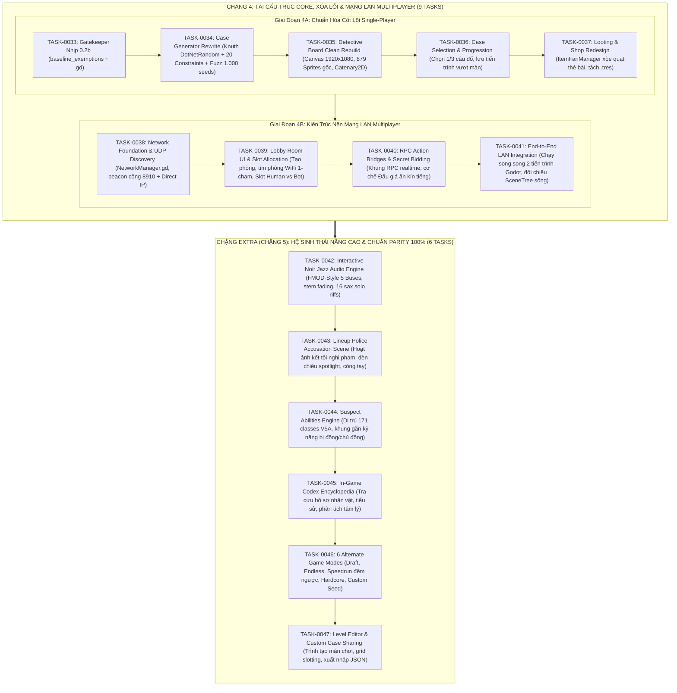

# Quy Hoạch Tổng Thể Toàn Diện: Chặng 4 (Tái Cấu Trúc Core & Mạng LAN) & Chặng Extra (Hệ Sinh Thái Nâng Cao & Chuẩn Parity 100%)

> **Tài Liệu Quản Trị**: `SPEC-MASTER-BLUEPRINT-P3` (v4.0)  
> **Target Project**: `Than_Tham_Nua_Voi_Godot/` (Godot 4.6.2, Cửa sổ Windowed GL 1920x1080)  
> **Căn Cứ Pháp Lý & Học Liệu**:  
> 1. Sổ cái kiểm toán Chặng 3: 1.533 classes C#, 13 handbooks bách khoa V1–V8, Master Encyclopedia, Cross-project mapping `[V]`.  
> 2. Báo cáo thực địa: `docs/agent-system/problems/Tua_game_nay_dang_co_van_de.txt` (xác nhận 100% các pain points) `[V]`.  
> 3. Cơ chế trần dòng code: `warn: 800 LOC`, `hard: 1000 LOC` per ADR-0010 DEC-AMEND-01 `[V]`.  
> 4. Kho Vault tài nguyên sạch: 879 sprites PNG, 155 samples PCM WAV, 6 fonts, shader `ContinuousWobble` `[V]`.

---

## 1. Tầm Nhìn Kiến Trúc & Sơ Đồ Hai Chặng Phát Triển

Dự án được phân rã thành **hai chặng chiến lược độc lập**:
- **Chặng 4 (`TASK-0033` $\rightarrow$ `TASK-0041`)**: Giải quyết triệt để mọi lỗi trong file `.txt`, tái cấu trúc các God-files, đưa trò chơi về trạng thái vận hành ổn định hoàn mỹ (Single-Player chuẩn mực) và xây dựng tầng nền Mạng LAN (UDP Discovery + Lobby slots Người/Bot + RPC Đấu giá ẩn). Mượn tạm tài nguyên Sprites/Audio gốc từ Vault để giao diện không bao giờ bị vỡ hay xấu.
- **Chặng Extra (`TASK-0042` $\rightarrow$ `TASK-0047`)**: Đưa toàn bộ các hệ sinh thái nâng cao của Dupery gốc vào Godot (Nhạc Noir Jazz thích ứng 5 buses, Hoạt ảnh kết tội Lineup cảnh sát, Khung kỹ năng nhân vật 171 classes, Bách khoa Codex, 6 Chế độ chơi phụ, và Trình tạo màn chơi Level Editor).

---

## 2. Kế Hoạch "Mượn Tạm Asset Gốc" Cho Fan-Game Vận Hành Ổn Định

Toàn bộ tài nguyên trích xuất từ Vault Chặng 3 sẽ được ánh xạ vào cấu trúc thư mục chuẩn của `Than_Tham_Nua_Voi_Godot/` để phục vụ cho các Task của Chặng 4:

| Nhóm Tài Nguyên | Tệp Nguồn Vault Chặng 3 | Thư Mục Đích Trong Fan-Game | Ứng Dụng Thực Tế |
| :--- | :--- | :--- | :--- |
| **Giao Diện & Thẻ Bài (UI Props)** | `docs/agent-system/evidence/dupery/vault/sprites_manifest.json` (879 sprites PNG / 59 sheets) | `Than_Tham_Nua_Voi_Godot/assets/ui/dupery_props/` | - 3 loại ghim (đỏ/vàng/xanh). - Khung thẻ bài Nine-Patch (co giãn chống tràn chữ). - Texture mặt bàn gỗ thám tử & giấy báo retro. - Kính lúp, kẹp giấy, thước đo, búa đấu giá. |
| **Âm Thanh Cốt Lõi (SFX PCM WAV)** | `docs/agent-system/evidence/dupery/vault/audio_samples_manifest.json` (155 samples WAV sạch) | `Than_Tham_Nua_Voi_Godot/assets/audio/sfx/` | - `pin_place.wav`, `pin_remove.wav` (cắm/rút ghim). - `string_drag.wav`, `string_snap.wav` (kéo/hủy dây). - `card_flip.wav`, `card_slide.wav` (lật/xòe bài quạt). - `auction_hammer.wav` (gõ búa đấu giá). |
| **Phông Chữ Chuyên Dụng (Typewriter Fonts)** | 6 fonts TTF/OTF trích xuất từ `Dupery_Data/StreamingAssets/` | `Than_Tham_Nua_Voi_Godot/assets/fonts/` | Phông máy đánh chữ cổ điển và tiêu đề báo chí Noir, hiển thị sắc nét 1080p, không bị vỡ hạt như font Godot mặc định. |
| **Shader Dây Ghim & Mực Rung** | `ContinuousWobble.gdshader` (từ handbook V8) | `Than_Tham_Nua_Voi_Godot/shaders/ContinuousWobble.gdshader` | Hiệu ứng rung nhẹ tự nhiên cho nét vẽ Line2D và thẻ bài giấy báo, xóa bỏ hoàn toàn cảm giác đơ cứng. |

---

## 3. Danh Mục Chi Tiết 9 Hợp Đồng Chặng 4 (`TASK-0033` $\rightarrow$ `TASK-0041`)

### Giai Đoạn 4A: Chuẩn Hóa Cốt Lõi Single-Player & Tái Cấu Trúc
1. **`TASK-0033` (Phase 0 - Gatekeeper Upgrade Nhịp 0.2b)**:
   - Bổ sung `.gd` vào `include_extensions` trong `project-config.json`.
   - Cấu hình `baseline_exemptions` cho 11 God-files cũ trong `Than_Tham_Nua_Voi_Godot` (cấm phình to thêm qua `check_diff_guard.py`).
   - Kích hoạt trần 800 warn / 1000 block LOC per ADR-0010 DEC-AMEND-01 cho mọi file code mới.
   - Mở rộng unit tests `tests/test_check_line_budget.py` đạt 100% pass.
2. **`TASK-0034` (Phase 3 - Pilot DO-02 CaseGenerator Rewrite)**:
   - Tách module Domain thuần: `DotNetRandom.gd` (Knuth subtractive generator) và `CaseConstraintSolver.gd` (20 Generation Constraints từ V2A).
   - Xây dựng Fuzz Test tự động 1.000 hạt giống ngẫu nhiên cam kết 100% vụ án sinh ra có duy nhất 1 đáp án hung thủ, triệt tiêu lỗi sượng câu đố.
   - Xóa `CaseGeneratorPublicSolver.gd` khỏi danh sách `baseline_exemptions`.
3. **`TASK-0035` (Phase 3 - Pilot DO-05 Detective Board & Suspect Card Clean Rebuild)**:
   - Clean Rebuild màn hình Giải đố (`VSCaseMain.tscn`) và Thẻ bài (`SuspectCard.tscn`) trên Canvas 1920x1080 pixel-snap.
   - Gắn trực tiếp 879 sprites gốc, áp dụng khung thẻ bài Nine-Patch co giãn thông minh, ghim chỉ dây Catenary2D từ V4.
   - Sửa dứt điểm lỗi mất chữ (font 5px) và lỗi tràn icon (`anchor_right = 1.42`), xóa 2 God-files cũ khỏi `baseline_exemptions`.
4. **`TASK-0036` (Phase 3 - Pilot DO-03 Case Selection System & Level Progression)**:
   - Xây dựng hệ thống Chọn 1 trong 3 câu đố (`CaseSelectionManager.gd`) và Tiến trình màn chơi (`LevelProgressionManager.gd`) từ học liệu V1/V3.
   - Thiết lập cơ chế lưu trữ tiến độ vượt màn (level progression) tương tự cơ chế qua màn của Candy Crush / Angry Birds.
5. **`TASK-0037` (Phase 3 - Pilot DO-01/04 Looting & Shop Screen Redesign)**:
   - Tái thiết kế màn hình Looting và Shop: Áp dụng cơ chế xòe quạt thẻ bài `ItemFanManager` từ V4, tạo không gian thoáng đãng trực quan.
   - Tách danh mục Dictionary cứng trong `AuctionCatalog.gd` sang các tệp `Custom Resource (.tres)` độc lập, xóa `AuctionCatalog.gd` khỏi `baseline_exemptions`.

### Giai Đoạn 4B: Xây Dựng Kiến Trúc Nền Mạng LAN Multiplayer
6. **`TASK-0038` (Phase 3 - Network Foundation & UDP LAN Discovery)**:
   - Tạo Autoload `NetworkManager.gd` (`ENetMultiplayerPeer`) quản lý kết nối Host/Client.
   - Xây dựng module `LANDiscovery.gd` dùng `PacketPeerUDP` phát beacon định kỳ trên cổng 8910 trong mạng WiFi để các máy tự dò tìm phòng mà không cần gõ IP.
   - Tích hợp phương thức kết nối Direct IP/Port dự phòng trường hợp router chặn broadcast.
7. **`TASK-0039` (Phase 3 - Lobby Room UI & Slot Allocation)**:
   - Xây dựng giao diện Phòng Chờ (Lobby): Nút Tạo phòng, danh sách phòng WiFi tự động cập nhật 1-chạm.
   - Quản lý Slot linh hoạt: Hỗ trợ phân bổ Slot Người chơi (Human) và Slot Bot (cho phép chọn 3 mức độ AI: Dễ, Vừa, Khó).
   - Tín hiệu RPC đồng bộ danh sách slot và trạng thái sẵn sàng (`player_ready`).
8. **`TASK-0040` (Phase 3 - RPC Action Bridges & Secret Bidding Network Hooks)**:
   - Thiết lập các RPC Action Hooks chuẩn hóa cho gameplay (`submit_solution`, `claim_loot`, `start_match`).
   - Xây dựng kiến trúc Đấu Giá Ẩn (Secret Bidding): Mỗi client gửi giá thầu kín qua RPC trực tiếp lên Host Server, Host phân xử tự động và công bố kết quả minh bạch, bảo mật màn hình 100%.
9. **`TASK-0041` (Phase 3 - End-to-End LAN Integration & Runtime Verification)**:
   - Khởi chạy song song 2 tiến trình Godot trong mạng nội bộ (1 Host, 1 Client) để kiểm thử kết nối, tạo phòng, vào phòng và gửi nhận gói tin realtime.
   - Đối chiếu SceneTree sống không dùng `--headless`, kiểm tra 100% test suite màu xanh, Subagent Peer-Auditor nghiệm thu PASS toàn bộ Chặng 4.

---

## 4. Danh Mục Chi Tiết 6 Hợp Đồng Chặng Extra (`TASK-0042` $\rightarrow$ `TASK-0047`)

Sau khi Chặng 4 hoàn thành và nghiệm thu, Chặng Extra sẽ được kích hoạt để đưa tựa game Fan-Game Thần Trùng đạt độ hoàn thiện bách khoa 100% so với game gốc Steam:

1. **`TASK-0042` (Chặng Extra - Interactive Noir Jazz Audio Engine)**:
   - Tái tạo hệ thống 5 buses trong Godot `AudioServer` (`Master`, `Music`, `SFX`, `Stems`, `Ambience`).
   - Nạp 155 samples WAV, xây dựng Autoload `AudioManager.gd` hỗ trợ hòa trộn thích ứng (stem fading 4 lớp nhạc cụ) theo nhịp độ suy luận và kích hoạt ngẫu nhiên 1 trong 16 đoạn saxophone solo khi nối đúng manh mối.
2. **`TASK-0043` (Chặng Extra - Lineup Police Accusation Cinematic Scene)**:
   - Dàn dựng màn hình kết tội nghi phạm với hoạt ảnh hàng cảnh sát xếp hàng (`LineupController`), đèn chiếu sân khấu (spotlight), hiệu ứng còng tay và âm thanh phán quyết tội phạm kịch tính.
3. **`TASK-0044` (Chặng Extra - Suspect Abilities Engine & Role Extensibility)**:
   - Di trú toàn bộ bộ engine 171 classes của V5A sang Godot: Cung cấp khung gắn kỹ năng bị động/chủ động cho nhân vật (áp dụng cho các nhân vật Thần Trùng như kỹ năng xem trộm manh mối, làm nhiễu lời khai, bảo kê nghi phạm).
4. **`TASK-0045` (Chặng Extra - In-Game Codex Encyclopedia)**:
   - Xây dựng giao diện Bách khoa toàn thư Codex trong game, cho phép tra cứu hồ sơ nhân vật, tiểu sử, phân tích tâm lý và bộ sưu tập các vụ án đã giải.
5. **`TASK-0046` (Chặng Extra - 6 Alternate Game Modes)**:
   - Tích hợp 6 chế độ chơi phụ từ V7: Draft Mode (chọn bài ngẫu nhiên), Endless Mode (vô tận tăng dần độ khó), Speedrun/Timer Mode (đếm ngược thời gian áp lực cao), Hardcore Mode, Custom Seed Mode, và Daily Case.
6. **`TASK-0047` (Chặng Extra - Level Editor & Custom Case Sharing)**:
   - Xây dựng bộ công cụ Level Editor hoàn chỉnh từ V8: Cho phép người chơi tự thiết kế câu đố trên Godot, cắm thẻ bài, gán manh mối, kiểm tra fuel/chips và xuất/nhập file JSON để chia sẻ cộng đồng.

---

## 5. Quy Chuẩn Kỹ Thuật & Kỷ Luật Quản Trị

1. **Quy Tắc Đơn Trách Nhiệm (Single Responsibility)**:
   - Tuyệt đối không tạo ra các God-file mới. Mọi script mới phải dưới trần 800 LOC warn / 1000 LOC block per ADR-0010 DEC-AMEND-01, với mục tiêu thiết kế chuẩn là `< 300 LOC`.
2. **Quy Tắc Server-Authoritative Trong Netcode**:
   - Máy Host (Server) là nguồn chân lý duy nhất (SSOT) cho toàn bộ trạng thái trò chơi (hạt giống sinh câu đố, đáp án vụ án, lượt chơi, kết quả đấu giá).
   - Máy Client chỉ gửi ý định hành động (Action Inputs) lên Host qua RPC; Host kiểm tra tính hợp lệ rồi broadcast trạng thái cập nhật về các Client.
3. **Quy Trình Nghiệm Thu Độc Lập Subagent Peer-Audit**:
   - 100% các Task từ `TASK-0033` đến `TASK-0047` bắt buộc phải qua Subagent Peer-Auditor độc lập kiểm toán đối kháng (chống cheat code né dòng, đối soát transcript, kiểm tra liên kết thực địa) trước khi cấp biên nhận `run_verify.py`.
