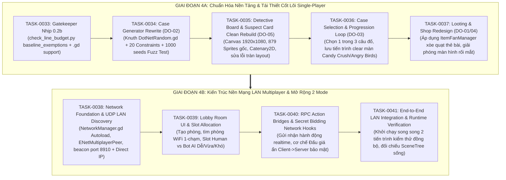

# Kế Hoạch Chi Tiết Chặng 4: Tái Cấu Trúc Godot Fan-Game & Kiến Trúc Nền Mạng LAN Multiplayer

> **Mã Kế Hoạch**: `PLAN-CHANG-004` (Chặng 4 / Phase 3)  
> **Căn cứ Thống nhất qua `/grill-me`**:  
> 1. File vấn đề thực địa: `docs/agent-system/problems/Tua_game_nay_dang_co_van_de.txt` `[V]`  
> 2. Kho tài sản & Cẩm nang bách khoa Chặng 3: 1.533 classes, 13 Handbooks, Master Encyclopedia, Cross-project mapping `[V]`  
> 3. Cơ chế trần định mức dòng code: `warn: 800 LOC`, `hard: 1000 LOC` per ADR-0010 DEC-AMEND-01 `[V]`  
> 4. Phạm vi Multiplayer LAN: Xây dựng tầng nền (Network Foundation, UDP LAN Discovery, Room/Lobby slots Human & Bot Easy/Medium/Hard, RPC action bridges) mà không can thiệp sâu vào luật tính điểm chi tiết `[V]`.

---

## 1. Phân Tầng Chiến Lược Chặng 4 (Hai Giai Đoạn 4A & 4B)

---

## 2. Bảng Phân Rã 8 Hợp Đồng Nguyên Tử Chặng 4 (`TASK-0033` $\rightarrow$ `TASK-0041`)

| Mã Task | Giai Đoạn | Mục Tiêu Kỹ Thuật Trọng Tâm | Tệp Phạm Vi (`in_scope`) | Tiêu Chí Nghiệm Thu Tất Định |
| :--- | :---: | :--- | :--- | :--- |
| **`TASK-0033`** | **4A** | Nâng cấp Gatekeeper Nhịp 0.2b: Bổ sung `.gd` vào `include_extensions`, kích hoạt `baseline_exemptions` cho 11 God-files cũ để cấm phình to thêm qua diff guard, chuẩn hóa trần 800 warn / 1000 block LOC. | `scripts/agent/check_line_budget.py`, `docs/agent-system/project-config.json`, `tests/test_check_line_budget.py` | `python scripts/agent/check_line_budget.py` exit code 0 trên toàn repo, 100% tests pass. |
| **`TASK-0034`** | **4A** | Pilot DO-02: Tái thiết toàn diện thuật toán sinh vụ án. Tách `DotNetRandom.gd` (Knuth subtractive generator tất định) và `CaseConstraintSolver.gd` (20 Generation Constraints từ V2A). Viết Fuzz Test 1.000 hạt giống chứng minh 100% câu đố có nghiệm duy nhất. | `Than_Tham_Nua_Voi_Godot/scripts/domain/cases/DotNetRandom.gd`, `CaseConstraintSolver.gd`, `CaseGenerator.gd`, `tests/test_case_generator_fuzz.py` | Fuzz test 1.000 seeds ngẫu nhiên đạt 100% unique evil answer, 0 unsolvable, xóa `CaseGeneratorPublicSolver.gd` khỏi `baseline_exemptions`. |
| **`TASK-0035`** | **4A** | Pilot DO-05: Clean Rebuild màn hình Giải đố (`VSCaseMain.tscn` và `SuspectCard.tscn`). Cố định Canvas 1920x1080 pixel-snap, nạp 879 sprites gốc, ghim chỉ dây Catenary2D, sửa dứt điểm lỗi mất chữ (font 5px) và tràn icon (`anchor_right = 1.42`). | `Than_Tham_Nua_Voi_Godot/scenes/case_gameplay/VSCaseMain.tscn`, `SuspectCard.tscn`, `scripts/presentation/case_gameplay/**` | Windowed GL probe render chuẩn xác 100% text và asset không tràn màn hình, xóa 2 God-files cũ khỏi `baseline_exemptions`. |
| **`TASK-0036`** | **4A** | Pilot DO-03: Xây dựng hệ thống Chọn 1 trong 3 câu đố (`CaseSelectionManager.gd`) và Tiến trình màn chơi (`LevelProgressionManager.gd`) từ học liệu V1/V3. Lưu dữ liệu tiến độ vượt màn (level progression) dạng Candy Crush / Angry Birds. | `Than_Tham_Nua_Voi_Godot/scripts/domain/cases/CaseSelectionManager.gd`, `LevelProgressionManager.gd`, `scenes/case_selection/**` | Unit test và kịch bản chọn 3 thẻ bài hoạt động trơn tru, lưu/nạp tiến trình màn chơi tất định. |
| **`TASK-0037`** | **4A** | Pilot DO-01/04: Tái thiết màn hình Looting và Shop. Áp dụng cơ chế xòe quạt thẻ bài `ItemFanManager` từ V4, phân bổ không gian thoáng đãng trực quan, thay thế hoàn toàn giao diện rối mắt cũ, tách `AuctionCatalog.gd` sang `Custom Resource (.tres)`. | `Than_Tham_Nua_Voi_Godot/scripts/domain/loot/ItemFanManager.gd`, `CustomResource` items, `scenes/loot/**` | Giao diện xòe quạt thẻ bài mượt mà, chuyển đổi hoàn toàn danh mục vật phẩm sang .tres, xóa `AuctionCatalog.gd` khỏi `baseline_exemptions`. |
| **`TASK-0038`** | **4B** | Xây dựng Tầng Nền Network LAN & Tự Động Tìm Phòng: Tạo Autoload `NetworkManager.gd` (`ENetMultiplayerPeer`), module `LANDiscovery.gd` dùng `PacketPeerUDP` phát beacon cổng 8910 trong mạng WiFi, tích hợp cơ chế kết nối Direct IP/Port dự phòng. | `Than_Tham_Nua_Voi_Godot/scripts/network/NetworkManager.gd`, `LANDiscovery.gd`, `project.godot` | Test socket UDP broadcast & listen tìm thấy phòng trong cùng loopback/LAN, Host mở port và Client kết nối thành công qua ENet. |
| **`TASK-0039`** | **4B** | Xây dựng Màn hình Phòng Chờ (Lobby Room UI): Giao diện Tạo phòng, danh sách phòng WiFi tự động cập nhật 1-chạm, quản lý Slot người chơi (Human) và Slot Bot (hỗ trợ chọn 3 mức độ thông minh: Dễ, Vừa, Khó). | `Than_Tham_Nua_Voi_Godot/scenes/lobby/LobbyRoom.tscn`, `LobbyRoomController.gd`, `scripts/network/RoomData.gd` | Tạo phòng, thêm bot với độ khó tùy chọn, client tham gia phòng và cập nhật slot realtime qua RPC tín hiệu. |
| **`TASK-0040`** | **4B** | Xây dựng Khung Giao Tiếp RPC & Đấu Giá Ẩn: Thiết lập các RPC action hooks chuẩn hóa (`submit_solution`, `player_ready`, `start_match`) và kiến trúc Đấu Giá Ẩn (Secret Bidding: mỗi Client gửi giá thầu kín qua RPC lên Server phân xử, không lộ màn hình). | `Than_Tham_Nua_Voi_Godot/scripts/network/NetworkActionBridge.gd`, `SecretBiddingManager.gd` | Mô phỏng 2-4 peers gửi bid bí mật, Server tổng hợp và công bố người thắng thầu chính xác qua RPC broadcast. |
| **`TASK-0041`** | **4B** | Tổng Kiểm Tra Tích Hợp Cuối Cùng Chặng 4 (End-to-End LAN Integration): Khởi chạy song song 2 tiến trình Godot kết nối qua mạng nội bộ, đối chiếu cây SceneTree sống với đồ thị tĩnh, xác nhận working tree sạch và nghiệm thu Chặng 4. | `scripts/agent/verify_lan_integration.py`, `tests/test_lan_integration.py`, `docs/agent-system/evidence/godot/**` | Chạy 2 tiến trình Godot song song kết nối phòng thành công, 100% test suite pass, Subagent Peer-Audit nghiệm thu PASS. |

---

## 3. Quy Tắc Kiểm Soát Bất Biến & Chống Lạc Hướng

1. **Nguyên Tắc Độc Bản Trước, Mạng LAN Sau (Clean Core First)**:
   - Giai đoạn 4A tập trung 100% vào việc giải quyết triệt để các lỗi nội tại của trò chơi (Case generator không còn sượng, Layout giải đố hiển thị hoàn mỹ 1920x1080, Looting dạng quạt bài trực quan).
   - Tuyệt đối không đưa logic mạng vào làm rối mã nguồn Domain thuần trong 4A.
2. **Nguyên Tắc Kiến Trúc Nền Mạng LAN (Foundation Only)**:
   - Trong Giai đoạn 4B, chỉ tập trung xây dựng tầng cơ sở hạ tầng (kết nối, tìm phòng Wifi, Lobby slot người/bot, RPC hooks).
   - Không tự ý can thiệp vào quy tắc tính điểm multiplayer phức tạp (để dành cho đồng nghiệp theo đúng yêu cầu).
3. **Kỷ Luật Dòng Lệnh & Chống Cheat Code (ADR-0010 DEC-AMEND-01)**:
   - Trần định mức: Cảnh báo tại 800 LOC, Chặn đứng tại 1000 LOC.
   - Mục tiêu thiết kế chuẩn: Mỗi module đơn trách nhiệm < 300 LOC.
   - Cấm mọi hành vi gộp dòng bằng dấu chấm phẩy `;` hoặc cắt xén bằng comment placeholder.
4. **Kiểm Toán Độc Lập Subagent Peer-Audit**:
   - 100% các Task từ `TASK-0033` đến `TASK-0041` đều bắt buộc qua Subagent Peer-Auditor độc lập kiểm toán đối kháng trước khi cấp biên nhận nghiệm thu `run_verify.py`.
